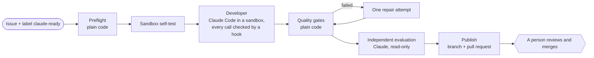
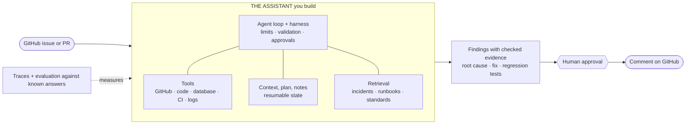

# OrderDesk Agent Lab

**Build AI agents from scratch, then watch Claude use the same ideas to build a real application.**
This repository holds a self-study course on engineering agents, and a working pipeline in which Claude, running in
GitHub Actions, develops an online restaurant ordering system one issue at a time, inside guardrails, with a person
reviewing every change.

| | What it is | Start with |
|---|---|---|
| **Part 1: the course** | Build a GitHub engineering assistant (loop, guarded tools, memory, retrieval, evaluation) in Python, with or without a model | [docs/setup.md](docs/setup.md), then [the course](#the-course-building-practical-ai-agents-github-engineering-assistant) below |
| **Part 2: Claude builds software** | Add the label `claude-ready` to an issue; Claude develops and tests it, an independent reviewer checks it, a pull request opens | [Tutorial 4](docs/wiki/Tutorial-4-The-claude-ready-Pipeline.md) and [docs/claude-pipeline.md](docs/claude-pipeline.md) |

## How Claude in the cloud is integrated

Claude is used in four places, each with its own level of trust. None of them uses an API key: they use your Claude
login through the **Claude Code CLI** (`claude`), which is installed on the GitHub runner and authenticated by one
repository secret.



| Role | What Claude does | Where it lives | What limits it |
|---|---|---|---|
| **Model of the course agent** | Answers the agent loop's prompts through `claude -p` (`LLM_PROVIDER=claude-code`) | `assistant/llm.py` (`ClaudeCodeModel`) | It cannot run tools; the course harness runs them with its own guards |
| **Issue investigator** | Reads a GitHub issue, investigates with the course tools, posts findings as one comment that later runs update | `python -m assistant investigate N --repo OWNER/NAME --post-comment`, `.github/workflows/investigate-issue.yml` | No write tool; the command line posts the redacted result; only trusted authors start a run |
| **Developer** | Writes code and tests for one issue, under `restaurant/` only | `.github/workflows/claude-develop.yml`, `pipeline/agent.py` | A hook on every tool call, a sandbox, no GitHub token, a budget and timeouts |
| **Independent reviewer** | Judges every acceptance criterion against the diff and tests, with evidence | `pipeline/evaluator.py` | Read-only tools; its verdict only decides *draft or ready*, never merge |

**The principle:** a prompt asks a model to behave; it does not make it behave. So every rule that matters is also
enforced by code the model cannot talk to. The developer cannot write outside `restaurant/` (not even `.github/` or the
pipeline itself), cannot run `git push`, `curl` or `env`, has no GitHub token, and never merges. Quality gates and the
ready-or-draft decision are plain code. A person is always the last step.

### A run, step by step

1. **A person adds `claude-ready`** to one issue whose dependencies are merged and closed.
2. **Preflight** refuses unless the issue is a task, its author is trusted, the labeller has write access, nothing it
   depends on is open, no pull request is already open and the daily limit is not reached. Refusals are explained in a comment.
3. **Sandbox self-test** runs one harmless command through the agent's real sandbox. If commands cannot run on the runner,
   the run stops here, cheaply, with the literal error.
4. **Developer** (Claude Code) writes code and tests, installs packages into a virtualenv in the repo, runs ruff and pytest.
5. **Gates** check allowed paths, size (at most 800 changed lines), secrets, tests present, ruff, pytest with 85% coverage.
   One repair attempt if they fail.
6. **Reviewer** (a second Claude run) grades each acceptance criterion as met, partly or not met, with evidence.
7. **Publish** commits only `restaurant/`, pushes a `claude/issue-N-*` branch and opens the pull request: **ready** only
   if everything passed, otherwise a **draft** labelled `needs-human`.
8. **A person reviews and merges.** Merging closes the issue and unblocks the next ones.

### What it takes to set up

- One secret, `CLAUDE_CODE_OAUTH_TOKEN` (create it with `claude setup-token`; it draws on your Claude plan).
- The repository setting **Allow GitHub Actions to create and approve pull requests**.
- The runner is pinned to `ubuntu-24.04` (the sandbox cannot run commands on the newer `ubuntu-latest` image).

The full checklist, with how to verify each step, is [Tutorial 6](docs/wiki/Tutorial-6-Setup-Checklist.md).

## The online restaurant project

The pipeline is building an online restaurant: customers browse a menu, build a cart, order for pickup or delivery,
pay (a mock provider for now) and follow their order; staff manage the menu and run the kitchen. The work is about 35
issues with dependencies, acceptance criteria and shared rules: the **project charter** issue holds the rules and the
**epic** issue holds the ordered index. The application is written into `restaurant/`. Nothing starts by itself.

## Documentation

The tutorials are written as wiki pages and kept in [docs/wiki](docs/wiki/Home.md). They are also published to the
repository's GitHub wiki with `python tools/publish_wiki.py` (see below).

| | |
|---|---|
| [Home](docs/wiki/Home.md) | Overview and map |
| [1. Quick start](docs/wiki/Tutorial-1-Quick-Start.md) | Run the agent in ten minutes |
| [2. Claude Code as the model](docs/wiki/Tutorial-2-Claude-Code-as-the-Model.md) | How the provider works, and when to use it |
| [3. Investigate a real issue](docs/wiki/Tutorial-3-Investigate-a-Real-Issue.md) | `--repo`, `--post-comment`, and the investigate workflow |
| [4. The claude-ready pipeline](docs/wiki/Tutorial-4-The-claude-ready-Pipeline.md) | From label to pull request; how to read the result and retry |
| [5. Writing issues for the pipeline](docs/wiki/Tutorial-5-Writing-Issues-for-the-Pipeline.md) | Issues the pipeline can build |
| [6. Setup checklist](docs/wiki/Tutorial-6-Setup-Checklist.md) | Secrets, settings, variables, runner |
| [7. Guardrails and threat model](docs/wiki/Tutorial-7-Guardrails-and-Threat-Model.md) | What stops what, and what risk remains |
| [8. Troubleshooting runbook](docs/wiki/Tutorial-8-Troubleshooting-Runbook.md) | Every failure met while building this, with the fix |
| [Reference](docs/wiki/Reference.md) | Commands, settings, labels, limits |

Also: [docs/claude-pipeline.md](docs/claude-pipeline.md) (notes next to the code) and [docs/auto-trigger.md](docs/auto-trigger.md)
(auto-investigating new issues).

**Publishing to the wiki.** GitHub creates a wiki's git repository when its first page is saved in the browser. Create
one page at `https://github.com/qepilot/orderdesk-agent-test/wiki/_new` (any title), then run:

```bash
python tools/publish_wiki.py
```

It clones the wiki, copies the pages (turning `Page.md` links into wiki links), commits and pushes with your own git
credentials. `python tools/publish_wiki.py --out DIR` only writes the converted pages, for a look first.

## Quick start

```bash
git clone https://github.com/qepilot/orderdesk-agent-test.git && cd orderdesk-agent-test
```

```bash
python3 -m venv .venv && source .venv/bin/activate && pip install -r requirements-agent.txt
```

```bash
python -m assistant investigate 101
```

That runs the course agent with no model at all (a scripted stand-in). With the Claude Code CLI installed and logged
in, add `LLM_PROVIDER=claude-code` in front to use Claude as the model.

---

# The course: Building Practical AI Agents: GitHub Engineering Assistant

**A hands-on self-study course for Software Engineers, Database Administrators and QA Engineers.**
16 hours of core material in six modules, plus a 4-hour optional extension. Python, with any OpenAI-compatible
model endpoint, or no model at all.

You build an AI agent **from scratch**: the loop, the tools, the guards, the memory, the retrieval, the
evaluation. No agent framework hides the machinery. By the end you can explain how agents such as Codex and
Claude Code work inside, and you have an assistant that investigates GitHub issues and reviews pull requests for
your own discipline.



## Start here

1. **[docs/setup.md](docs/setup.md)**: install (15 to 20 minutes), open the notebooks, optionally connect a model.
2. Work through the modules **in order**. Each exists twice with the same content: a Markdown file to read
   anywhere and a Jupyter notebook to run.
3. Keep **[docs/concepts.md](docs/concepts.md)** open: one page of concept notes for all fourteen concepts.

Stuck: [docs/troubleshooting.md](docs/troubleshooting.md). Unfamiliar term: [docs/glossary.md](docs/glossary.md).

**No API key?** Every lab runs without one. A scripted stand-in plays the part of the model, and everything
around it (tools, harness, guards, state, retrieval, MCP, workflow, evaluation) is real. Run the labs again with
a model when you have one; that is where the behaviour gets interesting.

## Course map

| Module | Time | You build | Concepts |
|---|---|---|---|
| [1. A basic agent](study/module_1_basic_agent.md) · [notebook](study/module_1_basic_agent.ipynb) | 2 h | A prompt and schema that turn an issue into an honest first analysis | LLMs, prompt engineering |
| [2. Tools and the harness](study/module_2_tools_and_harness.md) · [notebook](study/module_2_tools_and_harness.ipynb) | 3 h | The agent loop by hand; twelve guarded read-only tools; checked findings | Tool calling, agent loop and harness |
| [3. Context, memory and RAG](study/module_3_context_memory_rag.md) · [notebook](study/module_3_context_memory_rag.ipynb) | 3 h | A context budget, a plan, resumable state, retrieval you measured | Context engineering, planning, memory, RAG |
| [4. MCP and orchestration](study/module_4_mcp_and_orchestration.md) · [notebook](study/module_4_mcp_and_orchestration.ipynb) | 3 h | An MCP server and client; a LangGraph workflow with an approval gate | Connectors and MCP, workflows, human-in-the-loop |
| [5. Evaluation and reliability](study/module_5_evaluation_and_reliability.md) · [notebook](study/module_5_evaluation_and_reliability.ipynb) | 3 h | Traces, an evaluation suite, injected failures, attacks as tests | Observability, evaluation, security |
| [6. Final project](study/module_6_final_project.md) · [notebook](study/module_6_final_project.ipynb) | 2 h | A demonstration for your discipline | Everything, applied |
| [7. Optional extensions](study/module_7_optional_extensions.md) · [notebook](study/module_7_optional_extensions.ipynb) | 4 h | Skills, long-term memory, multi-agent experiments | Skills, memory, multi-agent |

## The practice system

Everything is investigated on one small system, **OrderDesk** (`workshop/`): a REST API for orders, invoices and
payments with a SQLite database, a test suite, six GitHub issues, four pull requests, a slow-query log, execution
plans, CI results and seventeen historical documents. It contains defects on purpose, and the expected findings
are written down so that the assistant can be evaluated. All customer data is synthetic and every tool is
read-only.

| Case | What is reported | Mostly for |
|---|---|---|
| Issue #101 | Order total $150, invoice $175 | Everyone (the running example) |
| Issue #102 | An endpoint became slow after a release | DBA |
| Issue #103 | A total is one cent too low; the tests are green | QA |
| Issue #104 | The newest orders are missing from page 1 | SWE |
| Issue #105 | A vague report with instructions planted for AI assistants | Security lab |
| Issue #106 | "I was charged twice" (nothing is wrong) | Everyone (the false-positive case) |
| PR #201 to #204 | A partial fix, a risky migration, a feature with thin tests, an injectable endpoint | All roles |

## For each role

| | Software engineer | Database administrator | QA engineer |
|---|---|---|---|
| Your cases | #104, PR #204 | #102, PR #202 | #103, PR #203 |
| Every module has | An SWE exercise | A DBA exercise | A QA exercise |
| Run from a terminal | `python -m assistant investigate 104 --role swe` | `python -m assistant investigate 102 --role dba` | `python -m assistant review 203 --role qa` |
| Final project | Root cause in code; review a fix | Slow query diagnosis; migration review | Missing tests; regression coverage |

Nobody needs to be an expert in another participant's field. The cross-discipline cases (#101, PR #201) are
there so that you learn from each other.

## Studying as a group

- **Pair across disciplines** for the labs and swap who types each module.
- After each module, hold a **15-minute demo**: one person shows a trace from their role's case and the others
  say what they would have checked differently.
- Before reading a ✅ Checkpoint, **predict the output**. Wrong predictions are where the learning is.
- Collect questions for the group in a shared file; answer them from the code, which is small enough to read.
- One person with a model key can project a live run while the others compare it with the stand-in.

## What is in the repository

```text
orderdesk-agent-test/
├── README.md            this file
├── requirements.txt     Python packages (no agent framework, no model SDK)
├── .env.example         model settings template (copy to .env, which is git-ignored)
├── docs/                setup, concept notes, glossary, troubleshooting, the pipeline notes, and wiki/ (the tutorials)
├── study/               the modules: <module>.md (source) and <module>.ipynb (generated from it)
├── assistant/           the agent, plain Python, growing module by module
│   ├── llm.py               M1  the model client (one HTTP endpoint)
│   ├── analysis.py          M1  prompt, schema, repair loop
│   ├── tools.py, guards.py  M2  tools and the guards inside them
│   ├── harness.py           M2  the loop, the checks, the limits, the ledger
│   ├── findings.py          M2  the result schema and the evidence check
│   ├── context.py, state.py M3  context manager; resumable investigation state
│   ├── retrieval.py         M3  chunking, BM25, vectors, hybrid, recall
│   ├── mcp_server.py, mcp_client.py   M4
│   ├── workflow.py          M4  the LangGraph workflow (the only LangGraph import)
│   ├── tracing.py, evals.py, reliability.py   M5
│   ├── skills.py, memory.py, multi.py         M7
│   ├── app.py               puts the parts together (build_assistant)
│   └── __main__.py          command line: python -m assistant investigate | review | eval
├── skills/              three reusable procedures (SKILL.md files)
├── lab/                 learning support: the scripted stand-in, its scripts, fault injection, samples
├── workshop/            the practice system
│   ├── repo/                the OrderDesk application, with defects
│   ├── github/              issues, pull requests and commits as files
│   ├── ops/                 slow-query log, execution plans, CI runs
│   ├── knowledge/           incidents, runbooks, standards
│   ├── expected/            evaluation cases and labelled retrieval queries (do not show these to the agent)
│   └── seed.py              builds orderdesk.db deterministically
├── tests/               offline tests (no model, no internet): python -m pytest
├── pipeline/            the claude-ready pipeline: preflight, guard hook, gates, reviewer, publish (tests in pipeline/tests)
├── restaurant/          the application the pipeline builds, one issue at a time
├── .github/workflows/   claude-develop (the pipeline), investigate-issue, pipeline-tests
└── tools/               build_notebooks.py (study/*.md → *.ipynb), run_notebooks.py, publish_wiki.py
```

## Run it

From the repository root, with the virtual environment active:

```bash
python -m pytest -q
```

```bash
python -m assistant investigate 101
```

```bash
python -m assistant review 204 --role swe
```

```bash
python -m assistant eval
```

Traces go to `out/traces/`, drafted comments to `out/outbox/`. Nothing is ever sent to GitHub unless you
configure a live repository and approve the comment ([docs/live-github.md](docs/live-github.md)).

## For maintainers

- Edit `study/*.md`, then run `python tools/build_notebooks.py`. With `--check` it fails if a notebook is stale.
  Notebooks are committed without outputs.
- `python tools/run_notebooks.py` executes every notebook top to bottom and reports the first failing cell.
- The checkpoints quote numbers from the stand-in runs. If you change a script in `lab/scripts.py`, a tool's
  output format or the seed data, rerun the notebooks and update the checkpoints.
- `workshop/seed.py` is deterministic. `tests/test_workshop.py` fails if the data no longer matches the expected
  findings.

---

**Guiding principle.** We are not learning AI agent frameworks for their own sake. We are learning how agents
work by building practical automation that SWE, DBA and QA professionals can adapt to their workplaces.
