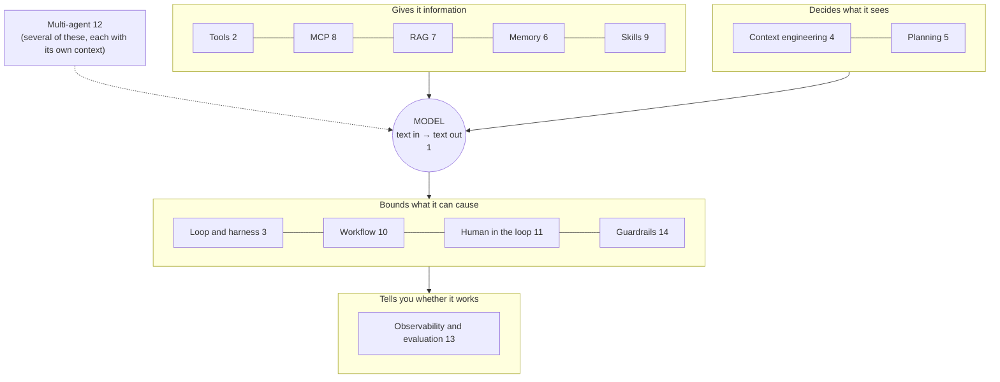

# Concept Notes

One page for all fourteen concepts of the course. Each note has the same shape: what it is, how the project uses
it, what to remember, the mistake people make, and where to find it. Read a note before the module that teaches
it and again after.

**The one idea behind all of them:** a model is a stateless function from text to text. Everything else is code
you write around that function, to give it information (tools, retrieval, memory), to decide what it sees
(context), to bound what it can cause (harness, guardrails, approval), and to find out whether it is right
(observability, evaluation).

| # | Concept | Module | Code |
|---|---|---|---|
| 1 | [LLMs and prompt engineering](#1-llms-and-prompt-engineering) | 1 | `assistant/llm.py`, `assistant/analysis.py` |
| 2 | [Tool calling](#2-tool-calling) | 2 | `assistant/tools.py` |
| 3 | [Agent loop and harness](#3-agent-loop-and-harness) | 2 | `assistant/harness.py` |
| 4 | [Context engineering](#4-context-engineering) | 3 | `assistant/context.py` |
| 5 | [Planning](#5-planning) | 3 | `update_plan` in `assistant/tools.py`, `assistant/app.py` |
| 6 | [Memory](#6-memory) | 3, 7 | `assistant/state.py`, `assistant/memory.py` |
| 7 | [RAG](#7-rag-retrieval-augmented-generation) | 3 | `assistant/retrieval.py` |
| 8 | [Connectors and MCP](#8-connectors-and-mcp) | 4 | `assistant/mcp_server.py`, `assistant/mcp_client.py` |
| 9 | [Skills and specialised instructions](#9-skills-and-specialised-instructions) | 1, 7 | `skills/`, `assistant/skills.py` |
| 10 | [Workflow orchestration](#10-workflow-orchestration) | 4 | `assistant/workflow.py` |
| 11 | [Human-in-the-loop](#11-human-in-the-loop) | 4 | `approver` in `assistant/harness.py`, `human_review` in `assistant/workflow.py` |
| 12 | [Multi-agent systems](#12-multi-agent-systems) | 7 | `assistant/multi.py` |
| 13 | [Observability and evaluation](#13-observability-and-evaluation) | 5 | `assistant/tracing.py`, `assistant/evals.py` |
| 14 | [Security and guardrails](#14-security-and-guardrails) | 2, 5 | `assistant/guards.py` |

---

## 1. LLMs and prompt engineering

**What it is.** A large language model takes a list of messages and returns one message. It keeps nothing
between calls, reads and writes tokens, and produces the most plausible continuation, which is not always the
true one. Prompt engineering is writing the input so that the plausible continuation is the one you want.

**In this project.** A system prompt that states the role, what the model cannot see, how to treat reports
(as claims), and an output schema. The answer is validated with Pydantic; an invalid answer goes back with the
validator's messages, at most three times.

**Remember.**
- Say what the model does **not** know. It cannot tell on its own.
- Give "I cannot determine this" a field. A model with an honest exit uses it.
- Describe the situation and the reason for a rule; do not shout commands.
- A schema guarantees shape, never truth. Validate in code anyway.

**Common mistake.** Asking for a diagnosis from a description alone and trusting the fluent answer.

**Try it.** Module 1, Lab B (a careless prompt) against Lab C (rules and a schema).

---

## 2. Tool calling

**What it is.** A convention on top of the text call: you describe functions (name, description, JSON Schema);
the model may answer with a request to call one; **your code** runs it and sends the result back. The model
never touches a system directly.

**In this project.** Twelve read-only tools for GitHub, code, the database and operations data, each a
Pydantic schema plus a Python function that returns text.

**Remember.**
- A tool is an API for a model: the description is its only documentation and is read on every call.
- Return errors as data (`ERROR kind=...: what happened, what to do next`), never as a crash.
- State units, limits and when to use the tool. Keep outputs short; they are paid for on every later step.
- General tools (`run_sql`) are flexible and need real guards; specialised tools are safe and rigid.

**Common mistake.** Believing "the model called the database", and so putting controls in the prompt.

**Try it.** Module 2, Lab A (one call by hand) and Lab B (write a tool).

---

## 3. Agent loop and harness

**What it is.** The loop: ask the model, run the tools it requested, give it the results, repeat until it
answers. The harness is everything around the loop: validation, permissions, limits, error handling, recording,
stopping. "Claude Code" and "Codex" are harnesses with a model inside.

**In this project.** `Agent.run` in about 150 lines: eight checks per tool call, five limits per run, a ledger
of every call, and a final answer that is itself a checked tool call.

**Remember.**
- The loop is twenty lines. The harness is the engineering.
- Prompts shape behaviour; code enforces boundaries. Limits are counted by code and are not negotiable.
- Every tool call gets a result, including failed ones, so the model can recover.
- Define stop reasons. A run always ends in a named state.

**Common mistake.** No step limit, no handling of unknown tools or bad JSON, and a final answer nobody checks.

**Try it.** Module 2, Lab C (three ways the bare loop breaks) and Lab D (the harness handles them).

---

## 4. Context engineering

**What it is.** Deciding what is in the model's input on each call. The context is bounded, every token in it is
paid for on every step, and irrelevant text lowers the quality of decisions.

**In this project.** Four levers, cheapest first: tools that return less (ranges, aggregates, caps); clipping
one oversized result with a visible marker; clearing old tool results from the view once a budget is passed;
persisting what matters in notes that are shown again after clearing.

**Remember.**
- A run's token bill is the **sum** of all its prompts, far more than the largest one.
- Tool definitions are a fixed charge per step. Offer the tools a task needs.
- Keep the record complete and shrink only the view.
- Never cut silently. A stub or a marker tells the model something is missing and how to get it.

**Common mistake.** Putting everything that might be useful into the system prompt "to be safe".

**Try it.** Module 3, Labs A and B.

---

## 5. Planning

**What it is.** Breaking a task into steps that can each be checked, keeping track of where you are, and knowing
when to stop.

**In this project.** A tool, `update_plan`, so the plan is a visible object in the state; and a stopping rule in
the prompt: the evidence explains the report, the scope is known, the fix can be named.

**Remember.**
- Verify the report before explaining it. Each step should be able to end the investigation early.
- A plan in a tool call can be saved, shown, resumed and evaluated. A plan in hidden reasoning cannot.
- Plans change. Let the model revise; cap the number of steps.
- Do not plan trivial tasks.

**Common mistake.** "Keep going until sure" (never stops) or "stop after N steps" (stops at the wrong place).

**Try it.** Module 3, Lab C.

---

## 6. Memory

**What it is.** Three different things share the name: the **conversation context** (messages, gone when the
run ends), **execution state** (what one task knows, on disk, survives a crash), and **long-term memory**
(lessons kept across tasks).

**In this project.** `InvestigationState` holds plan, facts, open questions, the calls already made and their
raw results, saved after every tool call; an interrupted run resumes with an empty context and repeats nothing.
The optional extension adds a store of lessons that only a person may add to.

**Remember.**
- The model writes judgements (plan, facts). Code writes the record (calls made, results).
- Persist the raw results too, or evidence from before an interruption cannot be verified.
- Long-term memory amplifies mistakes unless a person verifies what goes in.
- Often the better home for a lesson is a runbook, a skill or a test.

**Common mistake.** Calling a long conversation "memory", and losing everything on restart.

**Try it.** Module 3, Lab D (interrupt and resume); Module 7, Part B.

---

## 7. RAG (Retrieval-Augmented Generation)

**What it is.** Search a body of documents first, then put only the matching passages into the model's context,
so that it can use knowledge that is too large or too specific to be in the prompt or in its training.

**In this project.** Seventeen incidents, runbooks and standards, chunked with their titles; BM25 keyword
ranking written out in full; a vector index with a pluggable embedder; hybrid ranking by reciprocal rank fusion;
recall measured on labelled queries. Retrieval is an ordinary tool call, and quotes from retrieved documents are
checked like all other evidence.

**Remember.**
- Keyword search is exact and strong on identifiers; embeddings generalise to other wordings; hybrid combines them.
- Chunking and titles matter more than the ranking algorithm.
- Build a labelled query set and measure recall before tuning anything.
- You do not need a vector database until the corpus is large.
- As a tool, retrieval lets the agent search again in better words once it understands the problem.

**Common mistake.** Buying infrastructure before measuring whether the right document comes back.

**Try it.** Module 3, Labs E to G.

---

## 8. Connectors and MCP

**What it is.** A connector is the set of tools for one external system plus its authentication. The Model
Context Protocol is a standard way to offer tools from a separate process or server, so any agent can use them:
`initialize`, `tools/list`, `tools/call` as JSON-RPC.

**In this project.** The database, operations and knowledge tools served by a forty-line MCP server; a client
that wraps any MCP server's tools as ordinary harness tools; the same agent run on both.

**Remember.**
- The model never sees MCP. The harness has a client; the model only needs tool calling.
- Guards belong in the server, with the owner of the system.
- You pay with a process to run, a little latency, and descriptions written by someone else.
- A third-party server is code and prompt text you did not write. Allowlist its tools; keep the harness checks.

**Common mistake.** Reaching for MCP for a single agent with three local functions, or trusting any server.

**Try it.** Module 4, Labs A and B.

---

## 9. Skills and specialised instructions

**What it is.** Reusable instructions for a kind of task. In the simple form, a role paragraph added to the
prompt. In the full form, a file with a short description that is always visible and a body that is loaded only
when the task needs it (progressive disclosure).

**In this project.** Role lines for SWE, DBA and QA from Module 1 on; three `SKILL.md` procedures (SQL
performance, security review, test coverage) with a `load_skill` tool in Module 7.

**Remember.**
- Rules for every task go in the system prompt; procedures for some tasks go in skills; reference material goes
  in the knowledge base; anything that needs data or access is a tool.
- The description must say when to load the skill, in the words a task would use.
- Skills are trusted instructions: version them and review them like code.
- A skill grants no permission. Boundaries stay in code.

**Common mistake.** Writing a skill where a tool is needed, or loading skills from places untrusted people can edit.

**Try it.** Module 1, Lab D; Module 7, Part A.

---

## 10. Workflow orchestration

**What it is.** Fixing the order of steps in code instead of leaving it to the model: a graph of nodes over a
shared state, with a checkpoint after each node.

**In this project.** Six nodes in LangGraph: load, investigate (the agent loop), validate, draft, human review,
publish. One node contains a model. Checkpoints in SQLite let a run survive a crash and wait days for a person.

**Remember.**
- Agent loop for open-ended search; workflow for known procedure. Most systems are a loop inside a workflow.
- Use a workflow engine when you need durability and pauses, not merely because there are steps.
- Bound every retry loop and route failures to a person.
- Nodes that have side effects must be safe to run twice.

**Common mistake.** Drawing a graph for something a model should explore, or letting a model decide whether to
ask for approval.

**Try it.** Module 4, Labs C to E.

---

## 11. Human-in-the-loop

**What it is.** A person decides before something consequential happens, and the system can wait for them.

**In this project.** Two places: an approval gate at the end of the workflow (approve, edit or reject the exact
comment) and an approver on every tool marked as a write. With no approver attached, nothing risky runs.

**Remember.**
- Show the exact action, offer "edit", record who decided and why.
- Choose by reversibility: reading and drafting are free; posting, writing, paying and deleting ask first.
- Too many prompts get rubber-stamped. Remove risk in code where you can and ask rarely.
- A refusal is data returned to the model, not an exception.

**Common mistake.** "Are you sure?" on every tool call, or approval of a class of actions instead of one action.

**Try it.** Module 4, Labs D and F.

---

## 12. Multi-agent systems

**What it is.** Several agents, each with its own context and tools, working on parts of a task: run by code in
a fixed arrangement, or called by a lead agent as tools.

**In this project.** Three specialists (SWE, DBA, QA) reviewing one pull request with their findings merged,
compared against a single agent; and a lead with an `ask_specialist` tool.

**Remember.**
- The technical benefit is context isolation: a sub-agent reads a lot and returns a little.
- It helps when sub-tasks are independent, read-heavy, or need different permissions.
- It costs tokens (every agent pays its own overhead), lost context at hand-offs, merging, and harder debugging.
- Default to one agent with good tools and skills. Measure before splitting.

**Common mistake.** Adding agents because the diagram looks more capable.

**Try it.** Module 7, Part C.

---

## 13. Observability and evaluation

**What it is.** Observability: recording what happened in a run so you can explain it. Evaluation: running the
agent on cases with known answers and grading the results, so you can say whether it is right and whether a
change helped.

**In this project.** Five event types written to JSONL; a summary with tokens, cost and errors by kind; ten
cases with expected findings; graders in code for verdict, location, coverage, forbidden conclusions, grounding
and safety; an optional model judge.

**Remember.**
- Convincing is not correct. Only cases with known answers tell them apart.
- Test your graders with runs you know are bad.
- Include cases where the right answer is "nothing is wrong".
- Baseline, one change, rerun, compare quality **and** cost. With a live model, use pass rates over several runs.
- Grade the path as well as the outcome.

**Common mistake.** Judging by reading a few outputs, or tuning the prompt against the only test set.

**Try it.** Module 5, Labs A to E.

---

## 14. Security and guardrails

**What it is.** Making sure that what the agent can cause stays inside bounds whatever the model outputs,
including when text it reads tells it to misbehave (prompt injection).

**In this project.** Read-only SQL in three layers, a path jail and secret-file rule, row caps and redaction,
approval before posting, limits against runaway cost, a quote check against invented evidence, and all external
text marked as untrusted. Module 5 attacks all of it with a model that obeys the attacker.

**Remember.**
- Untrusted content must not control permissions. A control holds when the model does the wrong thing.
- Marking text as untrusted is a hint to the model, not a boundary.
- A leak needs private data, untrusted content and an outward channel. Remove or gate one of them.
- Prefer real boundaries (a read-only role, no access to the column) to filters after the fact.
- Turn every attack you think of into a regression test.

**Common mistake.** "The system prompt tells it not to."

**Try it.** Module 2, Lab E; Module 5, Lab G.

---

## Telling the neighbours apart

The course outline asks you to understand the practical differences between six terms that are often mixed up.

| Term | The question it answers | Not to be confused with |
|---|---|---|
| **Tool calling** | How does a model get something done? | MCP, which is one way of *delivering* tools |
| **Connector** | How do I reach system X, with authentication? | A single tool; a connector is a set |
| **MCP** | How do tools get to many agents without copying code? | A capability of the model; it is plumbing in the harness |
| **RAG** | How does the model use knowledge too large for the prompt? | Memory; RAG reads a shared corpus that others wrote |
| **Memory** | What does the agent keep, for how long? | Context, which is only what is in view right now |
| **Orchestration** | Who decides the next step, and what survives a crash? | Planning, which is the model's own ordering of its work |
