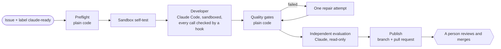

# OrderDesk Agent Lab

This repository has two parts that share one idea: **an AI agent is only useful when the code around it is strict.**

1. **A self-study course** where you build a GitHub engineering assistant from scratch: the agent loop, guarded tools, memory, retrieval, evaluation. It investigates issues and reviews pull requests.
2. **A pipeline where Claude, running in the cloud, builds a real application** (an online restaurant ordering system) one GitHub issue at a time. You add a label, Claude develops and tests the issue inside guardrails, an independent reviewer checks every acceptance criterion, and a pull request opens for a person to review.

## How Claude in the cloud is used

Claude is used in three roles, each with a different level of trust:

| Role | What it can do | What stops it doing more |
|---|---|---|
| **The model of the course agent** | Answers the agent loop's prompts through the Claude Code CLI (no API key) | It cannot run tools; the harness runs them, with its own guards |
| **The developer** | Reads and writes files under `restaurant/`, runs tests in a sandbox | A hook checks every tool call; no GitHub token; no network except the package index |
| **The reviewer** | Reads the diff and the code, judges each acceptance criterion | Read-only tools; its verdict only decides *draft or ready*, never merge |

## Start here

| If you want to... | Read |
|---|---|
| Run something in ten minutes | [Tutorial 1: Quick start](Tutorial-1-Quick-Start.md) |
| Use Claude as the model, with no API key | [Tutorial 2: Claude Code as the model](Tutorial-2-Claude-Code-as-the-Model.md) |
| Have Claude investigate a real GitHub issue | [Tutorial 3: Investigate a real issue](Tutorial-3-Investigate-a-Real-Issue.md) |
| See the label-to-pull-request pipeline end to end | [Tutorial 4: The claude-ready pipeline](Tutorial-4-The-claude-ready-Pipeline.md) |
| Write issues the pipeline can build | [Tutorial 5: Writing issues for the pipeline](Tutorial-5-Writing-Issues-for-the-Pipeline.md) |
| Set up a new repository the same way | [Tutorial 6: Setup checklist](Tutorial-6-Setup-Checklist.md) |
| Understand why it is safe (and where it is not) | [Tutorial 7: Guardrails and threat model](Tutorial-7-Guardrails-and-Threat-Model.md) |
| Fix something that broke | [Tutorial 8: Troubleshooting runbook](Tutorial-8-Troubleshooting-Runbook.md) |
| Look up a setting, label or command | [Reference](Reference.md) |

## The online restaurant project

Customers browse a menu, build a cart, order for pickup or delivery, pay (a mock provider for now) and follow their order; staff manage the menu and run the kitchen. The work is broken into about 35 issues with dependencies, acceptance criteria and shared rules. The ordered index is the **epic issue** in the repository's issue list, and the rules every task follows are in the **project charter** issue.

Nothing starts by itself. A person adds the label `claude-ready` to one issue whose dependencies are merged, reviews the pull request that comes back, and merges it. That unblocks the next issues.

## What has been verified, and what has not

- Real issues have gone from label to pull request on GitHub, and every pull request that was merged was reviewed and merged by a person. The pipeline never merges.
- Every guardrail that is code has tests. The command guard was also probed against the real Claude Code CLI with the prompt rules removed, and it refused every forbidden action.
- Known: the sandbox works on `ubuntu-24.04` and `ubuntu-22.04` and fails on the 26.04 image behind `ubuntu-latest`, so the workflow is pinned to 24.04. Not verified: quality on large or ambiguous issues. See [Troubleshooting](Tutorial-8-Troubleshooting-Runbook.md).
