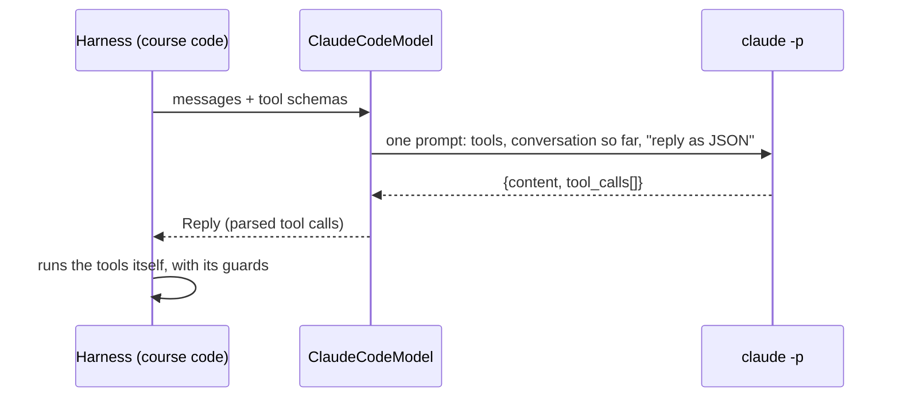

# Tutorial 2: Claude Code as the model

**Goal:** understand how the course agent can use Claude with no API key, and when to choose it.

## The idea

The course harness talks to "a model" through one small interface: give it messages and tool descriptions, get back text and tool calls. Normally that is an HTTP call to an OpenAI-compatible endpoint. With `LLM_PROVIDER=claude-code` the same interface is served by the **Claude Code CLI** (`claude -p`).



The important point: **Claude never runs your tools.** The CLI's own tools are switched off; it runs in an empty temporary directory and sees only the prompt. It *asks* for tool calls in a JSON reply, and the harness decides whether to run them. The guards, limits and evidence checks you build in the course apply unchanged.

## How a call works

- The conversation and the tool list are rendered into one prompt. Each call is stateless, so the whole conversation is sent again every time.
- The reply is forced into a fixed shape with `--json-schema`: `content` (text) and `tool_calls` (a list of `name` plus `arguments_json`).
- A short protocol is added to the system prompt: tools are *not* callable directly, only requested through `tool_calls`. Without it, the model tries to call `get_issue` natively, the CLI answers "No such tool available", and the model gives up. (This was the cause of an early run scoring 2 of 10 on the evaluation; the fix took it to 8 of 10.)
- Token usage comes back from the CLI and feeds the harness's budgets.

## Configure

In `.env` (or the environment):

| Setting | Meaning |
|---|---|
| `LLM_PROVIDER=claude-code` | Use the CLI as the model |
| `CLAUDE_CODE_MODEL` | Optional CLI model alias such as `sonnet`; empty means the CLI default |
| `LLM_BASE_URL`, `LLM_API_KEY`, `LLM_MODEL` | **Ignored** in this mode |
| `AGENT_MAX_STEPS`, `AGENT_MAX_SECONDS`, `AGENT_MAX_TOTAL_TOKENS`, `AGENT_MAX_FINAL_REJECTIONS` | Size of the harness's hard stops. Defaults are small because the stand-in finishes quickly; live models explore more, so 60 steps is a sensible start |

## Choosing between Claude Code and an API key

| | Claude Code CLI | API key (OpenAI-compatible) |
|---|---|---|
| Credentials | Your Claude login | A key and a billing account |
| Works in GitHub Actions | Yes, with an OAuth token | Yes, with a secret |
| Cost model | Draws on your Claude plan | Pay per token |
| Overhead | Every call restarts the CLI and re-sends the conversation | One HTTP call |
| Best for | Trying the course, repository automation | Heavy or repeated evaluation runs |

## Check it works

```bash
LLM_PROVIDER=claude-code python -m assistant investigate 102
```

Expected: a series of `MODEL ... -> tool names` lines, then findings. If the first model call fails, run `claude -p "say ok"` to check the CLI itself.

## Evaluate it

```bash
LLM_PROVIDER=claude-code python -m assistant eval
```

This runs the ten evaluation cases (six issues, four pull requests) with known answers and grades verdict, root-cause location, facts, forbidden conclusions, grounded quotes and safety. Results vary between runs, so treat a single number as indicative, not exact. In the runs made while building this, two cases (the prompt-injection case and the "I was charged twice" false-positive case) were the ones that sometimes failed, because the model concluded more than the evidence supported.
