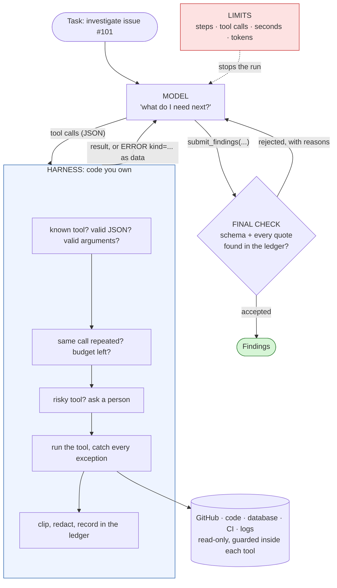
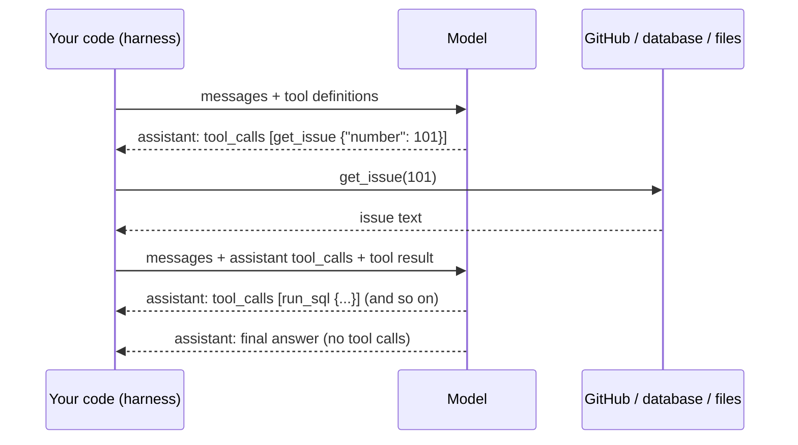

# Module 2: Tools and the Harness (3 hours)

**Course:** Building Practical AI Agents: GitHub Engineering Assistant
**Milestone:** the assistant retrieves code, database evidence and test results on its own, inside limits enforced
by code, and delivers findings whose evidence is checked
**Concepts:** tool calling (concept 2), the agent loop and harness (concept 3), with guardrails built in from the
start (concept 14)
**You will leave with:** the agent loop written by hand, a harness you can explain check by check, twelve
read-only tools, and a complete investigation of issue #101

> This file and `module_2_tools_and_harness.ipynb` have the same content. The notebook is built from this file.
> **Do Module 1 first.**

---

## The Big Picture

In Module 1 the model could only talk. Now it can ask for things to be done, and **your code** decides whether
and how they happen. The model proposes; the harness disposes.



<details>
<summary>▶ <b>Can't see the diagram? Text version</b></summary>

```text
task → MODEL decides what it needs → tool calls (JSON) → HARNESS
   harness checks: known tool, valid JSON, valid arguments, not a repeat, budget left, approval if risky
   harness runs the tool (which has its own guards), catches every exception, clips, redacts, records
   → result, or "ERROR kind=..." as data → back to MODEL
MODEL calls submit_findings → FINAL CHECK (schema; every quote must exist in a tool result)
   rejected → reasons go back to MODEL      accepted → findings
LIMITS (steps, tool calls, seconds, tokens) stop the run at any point, whatever the model wants.
```

</details>

**What "harness" means.** People say "Claude Code" or "Codex" and mean a model. What you actually use is a model
inside a harness: the program that holds the conversation, offers tools, runs them, enforces permissions, manages
the context and decides when to stop. The model is rented; the harness is engineering. This module builds one.

---

## How to Use This Self-Study Guide

| Part | What | Time |
|---|---|---|
| Part 1 | How tool calling works | 15 min |
| Lab A | One tool call, by hand, on the wire | 20 min |
| Lab B | Anatomy of a tool; write one | 25 min |
| Lab C | The agent loop in 20 lines, and three ways it breaks | 25 min |
| Lab D | The harness: the same failures, handled | 30 min |
| Lab E | Guards that live inside tools | 20 min |
| Lab F | The final answer is a tool call, and it is checked | 15 min |
| Lab G | A full investigation; your role's scenario | 25 min |
| Wrap-up | Exercises, quiz | 5 min |

**About the stand-in.** Without a model, the "model" in these labs is `lab/standin.py`: it plays back turns
written by hand in `lab/scripts.py`. The harness cannot tell: it validates, executes, limits and records scripted
calls exactly like real ones. Labs C, D and F **always** use scripts, even when you have a model, because they
need a model that misbehaves in a known way. That is also how harnesses are tested in practice.

---

## Setup

```python
import json
import sys
from pathlib import Path


def find_course_dir() -> Path:
    here = Path.cwd().resolve()
    for folder in [here, *here.parents]:
        for candidate in (folder, folder / "github-engineering-assistant"):
            if (candidate / "assistant" / "harness.py").exists():
                return candidate
    raise FileNotFoundError("Start Jupyter (or Python) from inside the course folder.")


COURSE_DIR = find_course_dir()
if str(COURSE_DIR) not in sys.path:
    sys.path.insert(0, str(COURSE_DIR))

from dotenv import load_dotenv

load_dotenv(COURSE_DIR / ".env")

from assistant.llm import llm_status, make_model
from assistant.workspace import default_workspace
from lab.scripts import SCRIPTS
from lab.standin import ScriptedModel

STATUS = llm_status()
USE_LLM = STATUS.ready
workspace = default_workspace()
print(STATUS)
print("Mode:", "live model" if USE_LLM else "scripted stand-in (no model configured)")
```

> **✅ Checkpoint.** `LLM ready` or `LLM NOT ready`, then the mode.

---

## Part 1: How Tool Calling Works

A model cannot run anything. "Tool calling" is a convention on top of the text-in, text-out call from Module 1:

1. With your request you send a list of **tool definitions**: a name, a description, and a JSON Schema for the
   arguments.
2. Instead of prose, the model may answer with **tool calls**: "call `get_issue` with `{"number": 101}`". This is
   still only text that the API has parsed into a structure.
3. **Your code** runs the function and appends the result as a `tool` message.
4. You call the model again with the longer history. It reads the result and either asks for more or answers.



Two consequences shape everything else:

- **The model never touches your systems.** Every effect in the world passes through a function you wrote. That
  function is where permissions, limits and logging belong.
- **The model chooses, guided only by names, descriptions and schemas.** A tool description is a prompt. A vague
  one produces wrong calls as surely as a vague system prompt produces wrong answers.

<details>
<summary>▶ <b>Note: tool calling, function calling, connectors, MCP: the same idea at different distances</b></summary>

| Term | What it is |
|---|---|
| **Tool calling / function calling** | The API convention above. Two names for one thing. |
| **Tool** | One function you expose, with its schema. |
| **Connector / integration** | A set of tools for one external system (GitHub, Jira, a database), plus its authentication. |
| **MCP** | A standard protocol for offering tools from a separate process or server, so that any agent can use them (Module 4). |

In this module the tools are Python functions in the same process. In Module 4 you will serve the same functions
over MCP and see that the agent loop does not change.

</details>

---

## Lab A: One Tool Call, by Hand

Start with the smallest possible case and do every step yourself. First, what a tool definition looks like on
the wire.

```python
from assistant.tools import github_tools, tool_schemas

gh_tools = {tool.name: tool for tool in github_tools(workspace)}
print(json.dumps(gh_tools["get_issue"].schema(), indent=2))
```

> **✅ Checkpoint.** `{"type": "function", "function": {"name": "get_issue", "description": ..., "parameters": {...}}}`.
> The `parameters` object is a JSON Schema generated from a Pydantic model. This JSON is sent with every request.

Now ask a question that needs the tool. The stand-in script for this lab is written inline so you can see exactly
what a "scripted model" is.

```python
LAB_A_SCRIPT = [
    {"say": "I need to read the issue first.", "calls": [{"name": "get_issue", "args": {"number": 106}}]},
    {"say": "The customer says their card was charged twice ($80.50 each) for order #6920 and wants one charge refunded."},
]
model = make_model() if USE_LLM else ScriptedModel(LAB_A_SCRIPT)

messages = [
    {"role": "system", "content": "You are an engineering assistant. Use the tools to look things up before you answer."},
    {"role": "user", "content": "Read GitHub issue #106 and tell me in one sentence what the customer claims."},
]
reply = model.complete(messages, tools=tool_schemas(list(gh_tools.values())))

print("finish_reason:", reply.finish_reason)
print("text         :", reply.content or "(none)")
for call in reply.tool_calls:
    print("tool call    :", call.id, call.name, call.arguments)
```

> **✅ Checkpoint.** `finish_reason: tool_calls` and one call: `get_issue {"number": 106}`. Nothing has been read
> yet. The model has only *asked*.

Run the tool yourself and append two messages: the assistant message that contains the request, and a `tool`
message with the result, linked by `tool_call_id`.

```python
call = reply.tool_calls[0]
result = gh_tools[call.name].fn(**call.args)

messages.append(reply.as_message())
messages.append({"role": "tool", "tool_call_id": call.id, "content": result})

print(json.dumps(messages[-2], indent=1))
print(json.dumps(messages[-1], indent=1)[:700], "...")
```

> **✅ Checkpoint.** An `assistant` message whose `tool_calls` holds the request, and a `tool` message whose
> `tool_call_id` matches. The result is wrapped in `<untrusted_content source="github issue #106">`.

Call the model again with the longer history.

```python
second = model.complete(messages, tools=tool_schemas(list(gh_tools.values())))
print("finish_reason:", second.finish_reason)
print("answer       :", second.content)
```

> **✅ Checkpoint.** `finish_reason: stop` and a one-sentence answer about being charged twice.

That is the entire mechanism. An agent is this exchange inside a loop.

<details>
<summary>▶ <b>Note: the rules of the message format that cause most 400 errors</b></summary>

- Every `tool` message must follow an `assistant` message whose `tool_calls` contains the same `id`.
- Every tool call must get a result, even when the tool failed. Send the error text as the result.
- `function.arguments` is a **string** containing JSON, not an object. Parse it; never search in it.
- If the model made three calls in one turn, append three `tool` messages before calling it again.
- Do not edit or drop messages in the middle carelessly: an orphaned `tool` message is rejected (Module 3 shows a
  safe way to shrink the history).

</details>

<details>
<summary>▶ <b>Note: several tool calls in one turn</b></summary>

A model may return more than one call at once ("read these two files"). They are independent by construction, so
a harness may run them in parallel. Ours runs them in order, for simplicity and readable traces. When you port
this to slow tools (network calls), running them concurrently is an easy win; return all results before the next
model call either way.

</details>

---

## Lab B: Anatomy of a Tool

A tool is an API whose only client is a model. The model reads its documentation on every call, cannot ask you
questions, and will call it with whatever arguments seem plausible. Design for that client.

Write one. It answers a question the Module 1 analysis asked for: "what are the line items of this order?"

```python
import sqlite3

from pydantic import BaseModel, Field

from assistant.guards import ToolError
from assistant.tools import Tool


class OrderOverviewArgs(BaseModel):
    order_id: int = Field(ge=1, description="The order number, for example 6800.")


def get_order_overview(order_id: int) -> str:
    conn = sqlite3.connect(f"file:{workspace.db}?mode=ro", uri=True)       # read-only connection
    try:
        order = conn.execute("SELECT customer_id, status, discount_code, created_at FROM orders WHERE id = ?",
                             (order_id,)).fetchone()
        if order is None:
            raise ToolError("not_found", f"There is no order {order_id}. Check the number in the issue.")
        items = conn.execute("SELECT quantity, unit_price_cents, status FROM order_items WHERE order_id = ? ORDER BY id",
                             (order_id,)).fetchall()
        invoice = conn.execute("SELECT total_cents, issued_at FROM invoices WHERE order_id = ?", (order_id,)).fetchone()
    finally:
        conn.close()
    lines = [f"order {order_id}: customer {order[0]}, status {order[1]}, discount code {order[2] or 'none'}, created {order[3]}",
             "items (quantity x unit price in cents, status):"]
    lines += [f"  {quantity} x {price} {status}" for quantity, price, status in items]
    lines.append(f"invoice: {invoice[0]} cents, issued {invoice[1]}" if invoice else "invoice: none")
    return "\n".join(lines)


order_tool = Tool(
    name="get_order_overview",
    description="Show one order: customer id, status, discount code, every line item with its status, and the "
                "invoice total if an invoice exists. Amounts are integer cents. Use it to check a reported amount "
                "before reading code. Read-only.",
    fn=get_order_overview,
    args_model=OrderOverviewArgs,
)

print(order_tool.fn(**order_tool.validate({"order_id": 6800})))
```

> **✅ Checkpoint.** Order 6800 with three items, the third one `removed`, and an invoice of 17500 cents.

Now call it the way a model sometimes will.

```python
for bad_arguments in ({"order_id": "the one in the issue"}, {"id": 6800}, {"order_id": 999999}):
    try:
        print(order_tool.fn(**order_tool.validate(bad_arguments)))
    except ToolError as error:
        print(f"{bad_arguments}\n  -> ERROR kind={error.kind}: {error.message}\n")
```

> **✅ Checkpoint.** Three refusals, each with a `kind` and a sentence that says what to do next:
> `invalid_arguments` twice (wrong type; wrong name) and `not_found`.

The five parts of a tool contract, as you just built them:

| Part | In `get_order_overview` | Why |
|---|---|---|
| **Name** | A verb and an object | The model picks by name first. |
| **Description** | What it returns, units, when to use it, that it is read-only | The only documentation the model gets. |
| **Argument schema** | `order_id: int >= 1`, with an example | Wrong calls are caught before anything runs. |
| **Output** | Short, labelled lines; cents stated | The model must read it, and it costs tokens on every later step. |
| **Errors as data** | `ToolError(kind, message with next step)` | The model can recover; the run does not crash. |

<details>
<summary>▶ <b>Note: one specialised tool, or one general tool?</b></summary>

The packaged assistant does not ship `get_order_overview`. It ships `run_sql`, which can answer this and a
thousand other questions. The trade-off is real and you will meet it at work:

| | Specialised (`get_order_overview`) | General (`run_sql`) |
|---|---|---|
| Steps to an answer | One | Often two or three (schema, then query) |
| What can go wrong | Little: fixed, parameterised query | The model writes SQL: wrong joins, huge results |
| Guarding | Easy: the function does one thing | Needs a real guard (Lab E) |
| New questions | Need a new tool and a deploy | Just work |
| Audit | "Looked at order 6800" | An arbitrary query to read |

A common shape: general read-only tools for investigation, narrow specialised tools for anything that changes
state. Exercise 1 measures the difference.

</details>

<details>
<summary>▶ <b>Note: writing descriptions a model can act on</b></summary>

- Say **when to use it and when not to**. "Use it to check a reported amount before reading code."
- State **units and formats**. "Amounts are integer cents." A model will otherwise report 17500 dollars.
- Say what a call **costs or limits**: "at most 200 lines per call", "up to 50 rows".
- Put the **next step into error messages**: "Check table and column names with describe_schema."
- Keep it truthful. If the description promises what the function does not do, the model plans around a fiction.

When a model misuses a tool, fix the description or the schema first. It is cheaper than a paragraph in the system
prompt, and it travels with the tool to every agent that uses it.

</details>

### The packaged tools

```python
from assistant.tools import investigation_tools

core_tools = investigation_tools(workspace)
for tool in core_tools:
    print(f"{tool.name:<18} {tool.risk:<5} {tool.description.split('. ')[0].rstrip('.')}.")
```

> **✅ Checkpoint.** Thirteen entries, all `read`: three tools for GitHub, three for code, three for the database,
> three for operations data, and `submit_findings` for the final answer. Read `assistant/tools.py` for one of them in full.

---

## Lab C: The Agent Loop in 20 Lines

Here is the whole idea of an agent, with nothing around it.

```python
def mini_loop(model, tools, system, task, max_steps=8):
    by_name = {tool.name: tool for tool in tools}
    messages = [{"role": "system", "content": system}, {"role": "user", "content": task}]
    for step in range(1, max_steps + 1):
        reply = model.complete(messages, tools=tool_schemas(tools))                # REASON
        messages.append(reply.as_message())
        if not reply.tool_calls:
            return reply.content, messages                                         # final answer
        for call in reply.tool_calls:
            result = by_name[call.name].fn(**call.args)                            # ACT
            messages.append({"role": "tool", "tool_call_id": call.id, "content": result})   # OBSERVE
            print(f"  step {step}: {call.name}({call.arguments[:70]}) -> {len(result)} chars")
    return "(stopped: step limit reached)", messages
```

Try it on issue #106, the customer who says they were charged twice.

```python
LAB_C_SCRIPT = [
    {"calls": [{"name": "get_issue", "args": {"number": 106}}]},
    {"calls": [{"name": "run_sql", "args": {"query": "SELECT kind, amount_cents, status, created_at FROM payments "
                                                     "WHERE order_id = 6920 ORDER BY created_at, id"}}]},
    {"say": "Customer 88 was charged once for order 6920. There is one successful capture of 8050 cents. The other "
            "entry is an authorization that was voided, which is a reservation and not a charge."},
]
SIMPLE_SYSTEM = ("You are an engineering assistant for the OrderDesk service. Use the tools to verify what an issue "
                 "reports before you answer. Answer in three sentences at most.")
read_tools = [tool for tool in core_tools if tool.name != "submit_findings"]

answer, history = mini_loop(make_model() if USE_LLM else ScriptedModel(LAB_C_SCRIPT), read_tools, SIMPLE_SYSTEM,
                            "Was the customer in GitHub issue #106 charged twice?")
print("\nANSWER:", answer)
```

> **✅ Checkpoint (stand-in).** Two steps (`get_issue`, `run_sql`), then an answer: charged once; the second
> entry is a voided authorization. A live model may take a different route (often `describe_schema` first).

Twenty lines, and it investigates. Now three ways it fails. These always use scripts.

**Failure 1: the model asks for a tool that does not exist.**

```python
try:
    mini_loop(ScriptedModel(SCRIPTS["broken-calls"]), read_tools, SIMPLE_SYSTEM, "Demonstration")
except Exception as error:
    print(f"The run died: {type(error).__name__}: {error}")
```

> **✅ Checkpoint.** `The run died: KeyError: 'open_file'`. One wrong name from the model and the whole
> investigation is lost, with everything gathered so far.

**Failure 2: the model repeats itself.**

```python
answer, history = mini_loop(ScriptedModel(SCRIPTS["runaway-loop"]), read_tools, SIMPLE_SYSTEM, "Demonstration",
                            max_steps=6)
print(answer, "| messages in history:", len(history))
```

> **✅ Checkpoint.** Six identical `get_issue` calls, then the step limit. Without `max_steps` this never ends, and
> every round sends a longer history than the one before.

**Failure 3: nothing checks what a tool is asked to do.** `mini_loop` runs whatever function is named with
whatever arguments arrive. If one of the tools could write, the model's output would be the only thing between a
planted instruction and your data. (Lab E deals with this.)

So the loop is the easy part. What makes it usable is everything around it.

---

## Lab D: The Harness

`assistant/harness.py` is the same loop with the missing parts added. Run the script that crashed `mini_loop`.

```python
from assistant.harness import BASE_SYSTEM_PROMPT, Agent, Limits


def show(result):
    print(f"status={result.status}  stop_reason={result.stop_reason}  steps={result.steps}  tool_calls={result.tool_calls}")
    for record in result.ledger:
        mark = "ok " if record.ok else "ERR"
        print(f"  step {record.step:>2} {mark} {record.name:<16} {record.output[:105]!r}")


result = Agent(ScriptedModel(SCRIPTS["broken-calls"]), core_tools, system=BASE_SYSTEM_PROMPT).run("Demonstration")
show(result)
```

> **✅ Checkpoint.** The run **completes** (`stop_reason=submitted`). Four of its seven calls failed and each came
> back to the model as data:
> `unknown_tool` (a tool that does not exist), `invalid_json` (arguments cut off), `invalid_arguments` (wrong
> names and types), then a good call, then `sql_error` (a table that does not exist), then two good calls.

Read the error texts. Each says what was wrong **and what to do next**: the available tools, "send the arguments
as one JSON object", "check table and column names with describe_schema". The script's next turn does exactly
that. A real model does too, most of the time, which is why "errors as data" is the single most valuable habit in
tool design.

Now the runaway loop.

```python
result = Agent(ScriptedModel(SCRIPTS["runaway-loop"]), core_tools, system=BASE_SYSTEM_PROMPT,
               limits=Limits(max_steps=6)).run("Demonstration")
show(result)
```

> **✅ Checkpoint.** `status=stopped  stop_reason=max_steps`. The first two calls ran; from the third on the
> harness answered `repeated_call` without touching the tool.

And a model that stops without delivering a result.

```python
result = Agent(ScriptedModel(SCRIPTS["no-final-answer"]), core_tools, system=BASE_SYSTEM_PROMPT).run("Demonstration")
show(result)
print("findings:", result.findings)
print("last message sent to the model:", result.messages[-2]["content"])
```

> **✅ Checkpoint.** `stop_reason=no_final_answer`, `findings: None`. The harness reminded the model once to call
> `submit_findings`, then stopped. A chatty non-answer is reported as what it is, not passed on as a result.

### What the harness checks, in order

Open `assistant/harness.py` and find each row in `Agent._execute` and `Agent.run`.

| # | Check | On failure the model receives | Why in code, not in the prompt |
|---|---|---|---|
| 1 | Is there such a tool? | `unknown_tool` + the list | Models invent plausible names. |
| 2 | Are the arguments JSON? | `invalid_json` | Long arguments get truncated. |
| 3 | Do they match the schema? | `invalid_arguments` + field errors | The model is a caller like any other. |
| 4 | Same call as before, twice already? | `repeated_call` | Cheap loop detection. |
| 5 | Is the tool risky (`risk="write"`)? | `not_approved` unless a person says yes | Module 4. |
| 6 | Final answer: does it pass the final check? | `findings_rejected` + reasons | Lab F. |
| 7 | Did the tool raise? | `ToolError` kind, or `tool_failed` | A bug in a tool must not end the run. |
| 8 | Is the result too long? | Clipped, with a marker | One query must not flood the context. |

And the limits, checked every step, never negotiable:

```python
print(Limits())
```

| Limit | Stops | The failure it prevents |
|---|---|---|
| `max_steps` | model calls | Loops; "one more check" forever |
| `max_tool_calls` | tool executions | A model that fans out 30 calls per step |
| `max_seconds` | wall time | Slow tools, hung endpoints |
| `max_total_tokens` | spend | A surprising bill |
| `max_final_rejections` | resubmissions | Arguing with the final check |

<details>
<summary>▶ <b>Note: why limits are not mentioned in the system prompt</b></summary>

You can tell a model "use at most 25 steps" and it will often comply. Often is not a limit. The harness counts
and stops; no output of the model can change the count. Telling the model about a budget is useful as a *hint*
for pacing (some APIs have a feature for it), but the enforcement must not depend on the model's cooperation.

The same division applies everywhere in this course: **prompts shape behaviour, code enforces boundaries.**

</details>

<details>
<summary>▶ <b>Note: how this maps to Claude Code, Codex and agent frameworks</b></summary>

| In this course | In a product harness |
|---|---|
| `Agent.run` loop | The same loop, usually streaming |
| `Tool` with schema and `risk` | Built-in tools (read, edit, shell, search) plus yours |
| `approver` callback | Permission prompts, allow and deny rules, "auto" modes |
| `Limits` | Turn limits, token and cost budgets, timeouts |
| `ToolRecord` ledger | Session transcript, audit log |
| `final_check` | Stop hooks, structured output validation |
| Guards inside tools | Sandboxes: filesystem and network restrictions enforced by the OS |
| `context` hook (Module 3) | Automatic compaction, context editing |

Frameworks (LangChain's `create_agent`, the OpenAI Agents SDK, the Claude Agent SDK, Pydantic AI) package this
loop with their own names for the same parts. After this module you can read any of them and ask the right
questions: where are the limits, what happens to a tool exception, who approves a write.

</details>

---

## Lab E: Guards That Live Inside Tools

The harness checks *how* the model calls tools. It cannot know what a query does. That knowledge lives in the
tool. `run_sql` is the most dangerous tool we have, so it has three independent layers.

```python
tools_by_name = {tool.name: tool for tool in core_tools}
run_sql = tools_by_name["run_sql"]

for query in ["SELECT status, COUNT(*) AS orders FROM orders GROUP BY status",
              "UPDATE invoices SET total_cents = 15000 WHERE order_id = 6800",
              "SELECT 1; DROP TABLE orders",
              "WITH doomed AS (SELECT 1) DELETE FROM invoices",
              "SELECT * FROM invoice_lines"]:
    try:
        print(f"{query}\n{run_sql.fn(query=query)}\n")
    except ToolError as error:
        print(f"{query}\n  -> ERROR kind={error.kind}: {error.message}\n")
```

> **✅ Checkpoint.** The first query returns four rows. Then `write_refused`, `multiple_statements`,
> `write_refused` (the DELETE hidden behind a CTE), and `sql_error` with the hint to use `describe_schema`.

That was layer 1, a text check. Text checks have holes; assume yours does. Pretend it lets everything through
and see what the other layers do.

```python
import assistant.guards as guards

original_check = guards.check_read_only_sql
guards.check_read_only_sql = lambda query: query            # simulate a hole in the text check
try:
    guards.run_read_only(workspace.db, "UPDATE invoices SET total_cents = 0 WHERE order_id = 6800")
    print("the write went through")
except ToolError as error:
    print(f"still refused -> kind={error.kind}: {error.message}")
finally:
    guards.check_read_only_sql = original_check
```

> **✅ Checkpoint.** `still refused -> kind=write_refused: The database refused this statement: access is read-only.`

| Layer | What it is | What it is good for |
|---|---|---|
| 1. Statement check | Code that reads the SQL text | A clear message the model can act on |
| 2. Authorizer | The database engine refuses every action except reading | Catches whatever the text check missed |
| 3. Read-only connection | The file is opened with `mode=ro` | The real permission: a read-only database user |
| + Row cap, time limit | 50 rows, 5 seconds | Protects the context and the run |

At work, **layer 3 comes first**: give the agent a database role that can only `SELECT` from the tables it needs,
on a replica. Layers 1 and 2 make refusals readable; they are not the reason the data is safe.

Files have the same kind of guard, and everything that leaves a tool passes a redaction filter.

```python
read_file = tools_by_name["read_file"]
for path in ("orderdesk/pricing.py", ".env", "../seed.py", "/etc/passwd"):
    try:
        print(read_file.fn(**read_file.validate({"path": path}))[:200], "\n")
    except ToolError as error:
        print(f"{path}\n  -> ERROR kind={error.kind}: {error.message}\n")

print(run_sql.fn(query="SELECT id, name, email FROM customers WHERE id IN (88, 123)"))
```

> **✅ Checkpoint.** `pricing.py` is shown with line numbers inside `<untrusted_content>`. `.env` is refused as
> `secret_file`; the other two as `path_outside_repo`. The customer rows show `[email redacted]`.

<details>
<summary>▶ <b>Note: why file contents and issues are wrapped in &lt;untrusted_content&gt;</b></summary>

Anything the assistant reads may contain instructions: an issue (you saw #105), a code comment, a document, a log
line. `assistant/guards.untrusted` wraps such text and the system prompt says that text inside those tags is data.
As in Module 1, this lowers the chance that the model obeys planted text. It does not remove it. What actually
protects the system is that no tool in this module can change anything, read a secret, or reach outside the
repository, **whatever** the model decides. Module 5 tests that claim with a model that obeys the planted text.

</details>

---

## Lab F: The Final Answer Is a Tool Call, and It Is Checked

How does the loop know the model is done, and how do you get a result your code can use? The assistant's last
action is a tool call: `submit_findings`. Its arguments are the result.

```python
from assistant.findings import Findings, check_findings

for name, field in Findings.model_fields.items():
    print(f"{name:<17} {field.description or ''}"[:118])
```

Two properties make this better than parsing a final paragraph:

- The harness validates the arguments against `Findings` like any other tool call. A missing `verdict` is an
  `invalid_arguments` error the model can fix.
- The harness can **refuse** the answer. `check_findings` requires evidence for a conclusion and looks for every
  evidence quote in the tool results of this run. A quote that was never seen is rejected.

Watch a model that makes things up.

```python
result = Agent(ScriptedModel(SCRIPTS["invented-evidence"]), core_tools, system=BASE_SYSTEM_PROMPT,
               final_check=check_findings).run("Investigate issue #101")
show(result)
print("\nThe rejection, in full:\n", result.ledger[1].output)
print("\nAccepted verdict:", result.findings["verdict"], "| evidence:", result.findings["evidence"])
```

> **✅ Checkpoint.** The first `submit_findings` (a double tax in a file `orderdesk/tax.py` that does not exist) is
> rejected: both quotes "not found in any tool result of this run". The script then looks at the data and submits
> a weaker but supported result (`needs_more_info`, one real quote), which is accepted.

This check cannot tell whether a conclusion is *right*. It guarantees something narrower and very useful: every
piece of quoted evidence exists and was seen in this run. A reviewer can open each reference and find it.

<details>
<summary>▶ <b>Note: what the quote check can and cannot catch</b></summary>

| It catches | It does not catch |
|---|---|
| Files, lines, rows and log entries that do not exist | A true quote that does not support the conclusion |
| Numbers "remembered" from training data | A wrong root cause argued from real evidence |
| Evidence from a tool call that was planned but never made | Missing evidence: the thing nobody looked at |

Module 5 measures the second column with evaluation cases whose answers are known.

</details>

---

## Lab G: A Full Investigation

Everything together on issue #101. With a model configured this is a live run; otherwise the reference script.
The tracer prints each event as it happens.

```python
from assistant.app import issue_task
from assistant.findings import render_markdown
from assistant.tracing import Tracer
from lab.models import model_for

tracer = Tracer(echo=True)
agent = Agent(model_for("issue-101"), core_tools, system=BASE_SYSTEM_PROMPT, final_check=check_findings, tracer=tracer)
result = agent.run(issue_task(101))
```

> **✅ Checkpoint (stand-in).** 8 model calls, 11 tool calls, `completed (submitted)`. Read the trace top to bottom:
> issue → two queries → code search → two file reads → commits → two more queries → test search → findings.
> **Live:** the path will differ. Check the same things: did it verify the numbers before reading code, did it
> find both code paths, did it count the affected invoices?

```python
print(render_markdown(result.findings))
```

> **✅ Checkpoint.** `defect_confirmed`; root cause in `orderdesk/invoicing.py` (`INVOICE_SUBTOTAL_SQL` has no
> status filter); 46 affected invoices; the customer was charged the correct amount.

Compare with Module 1. The analysis there listed four things under *cannot determine*: which amount is right,
whether the customer was overcharged, how many invoices are affected, the root cause. Each now has an answer with
a quote behind it.

```python
usage = result.usage
print(f"model calls: {result.steps}   tool calls: {result.tool_calls}")
print(f"tokens in (summed over all calls): {usage.input_tokens}   tokens out: {usage.output_tokens}")
print(f"largest single prompt: {max(e['input_tokens'] for e in tracer.events if e['event'] == 'model_call')}")
```

Note the first number against the last. The conversation never exceeded a few thousand tokens, yet the run paid
for many times that, because every step sends the whole history again. Module 3 is about that.

### Your role's scenario

Run the case closest to your work and read its trace. Change `MY_CASE` and rerun.

| Role | Case | What to look for in the trace |
|---|---|---|
| SWE | `issue-104` | Does it trace API → service → repository before concluding? |
| DBA | `issue-102` | Does it compare both execution plans and find the migration? |
| QA | `issue-103` | Does it explain why the existing tests passed? |
| Anyone | `issue-106` | Does it conclude "no defect" with evidence instead of inventing one? |

```python
MY_CASE = "issue-104"      # issue-102, issue-103, issue-104 or issue-106

my_tracer = Tracer(echo=True)
my_result = Agent(model_for(MY_CASE), core_tools, system=BASE_SYSTEM_PROMPT, final_check=check_findings,
                  tracer=my_tracer).run(issue_task(int(MY_CASE.split("-")[1])))
print()
print(render_markdown(my_result.findings) if my_result.findings else f"stopped: {my_result.stop_reason}")
```

> **✅ Checkpoint.** A completed run with findings for your case. Before reading the findings, write down what you
> would have checked yourself; then compare.

The same thing from a terminal: `python -m assistant investigate 104 --role swe`.

---

## What You Built

| File | What it holds |
|---|---|
| `assistant/tools.py` | The `Tool` class and the tool sets |
| `assistant/guards.py` | Read-only SQL in three layers, path jail, secret files, redaction, clipping |
| `assistant/harness.py` | The loop, the eight checks, the limits, the ledger |
| `assistant/findings.py` | The findings schema and the quote check |
| `tests/test_harness.py`, `tests/test_guards.py` | The failures of this module as regression tests |

---

## Exercises

**Everyone**

1. **Specialised versus general.** Add `order_tool` from Lab B to the tool list (`core_tools + [order_tool]`) and
   run issue #101 with a live model. Does the number of steps or tokens change? Does the model use it? Then make
   its description vague ("Gets order info") and run again.
2. **Find the limits.** Run issue #101 with `Limits(max_steps=5)`, then with `Limits(max_total_tokens=8000)`.
   What is the stop reason each time, and what is lost? (Module 3 makes an interrupted run resumable.)
3. **Read a test.** Open `tests/test_harness.py::test_planted_instructions_cannot_write_read_secrets_or_post`.
   Which line proves that no comment was posted?

**SWE**

4. Write a tool `get_function(path, name)` that returns the source of one function (use Python's `ast` module to
   find its line range, then reuse `read_file`). Add it to the agent and run `issue-104`. Does the trace get shorter?

**DBA**

5. Write a tool `table_stats(table)` that returns row count, the five most frequent values of a named column, and
   the indexes. Decide what must be validated (the table name goes into SQL: look at how `describe_schema` in
   `assistant/tools.py` avoids injection). Run `issue-102` with it.

**QA**

6. Write a tool `get_test_source(test_name)` that finds a test function by name under `tests/` and returns its
   source with the assertions marked. Run `issue-103` and check whether the agent's explanation of "why the tests
   passed" improves.

---

## Quiz

<details>
<summary><b>1. "The model called the database." What is wrong with that sentence, and why does it matter?</b></summary>

The model wrote text asking for a query. Your code decided to run it. It matters because that decision point is
where every control lives: validation, permissions, limits, logging. If you believe the model acts directly, you
will put the controls in the prompt, where they do not hold.

</details>

<details>
<summary><b>2. A tool raises an exception for a bad argument. A second tool returns "ERROR kind=invalid_arguments: ...". Which is better for an agent and why?</b></summary>

The second. An exception either ends the run or reaches the model as a stack trace it cannot use. An error
returned as data, with a stable kind and a next step, lets the model correct itself in the same run, and lets your
reports count failures by kind.

</details>

<details>
<summary><b>3. Why does run_sql have three layers when the first one already refuses writes?</b></summary>

Each layer fails differently. A text check can be fooled by syntax it did not anticipate. The engine's authorizer
and a read-only connection do not depend on reading SQL correctly. The first layer exists for good error messages;
the last is the actual permission. Defence in depth means a hole in one layer is not a breach.

</details>

<details>
<summary><b>4. The agent's findings passed the quote check. What do you know, and what do you still not know?</b></summary>

Known: every quoted piece of evidence appeared in a tool result during the run. Not known: whether the evidence
supports the conclusion, whether the conclusion is right, and whether something important was never looked at.

</details>

<details>
<summary><b>5. Where would you put a rule like "never read more than 200 lines of a file at once": the system prompt, the tool description, or the tool's code?</b></summary>

The code enforces it (the cap). The description tells the model about it so it can plan ("at most 200 lines per
call ... search first"). The system prompt does not need it. Rule of thumb: enforce in code, explain in the
description, keep the system prompt for how to work.

</details>

---

## Checklist Before Module 3

- [ ] I did one tool call by hand and can name the two messages that must be appended.
- [ ] I wrote a tool and saw it refuse three kinds of bad call.
- [ ] I can list the eight checks of the harness and the five limits.
- [ ] I bypassed the first SQL layer and saw the next one hold.
- [ ] I ran a full investigation for my role and compared its path with my own.

**Next:** [Module 3: Context, memory and RAG](module_3_context_memory_rag.md). The assistant gets a budget for
what it reads, a plan, notes that survive an interruption, and a way to search the team's history.
