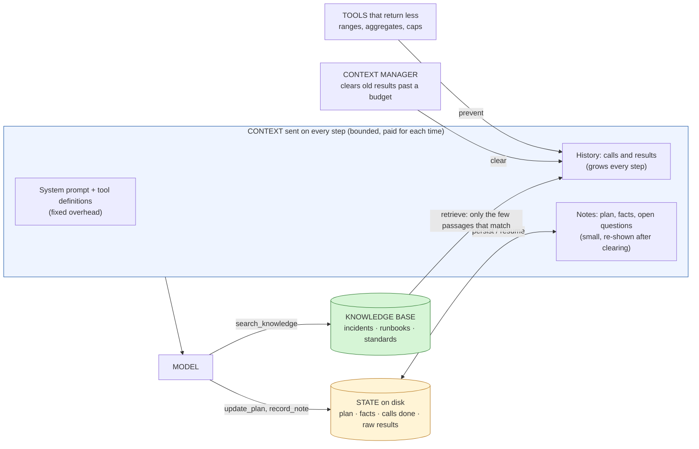

# Module 3: Context, Planning, Memory and RAG (3 hours)

**Course:** Building Practical AI Agents: GitHub Engineering Assistant
**Milestone:** the assistant investigates a complex issue with a plan, keeps its context small, survives an
interruption, and supports its diagnosis with historical evidence
**Concepts:** context engineering (4), planning (5), memory (6), retrieval-augmented generation (7)
**You will leave with:** a measured picture of where tokens go, four ways to spend fewer, an investigation state
that can be resumed, and a retrieval system you built and measured without a vector database

> This file and `module_3_context_memory_rag.ipynb` have the same content. The notebook is built from this file.
> **Do Module 2 first.**

---

## The Big Picture

The model's context is the only thing it knows during a call, and you pay for all of it on every step. This
module is about deciding what goes in.



<details>
<summary>▶ <b>Can't see the diagram? Text version</b></summary>

```text
CONTEXT (sent on every step) = system prompt + tool definitions (fixed)
                             + history of calls and results (grows)
                             + notes: plan, facts, open questions (small)
Four things keep it small and useful:
  prevent   tools return ranges, aggregates and capped results
  clear     a context manager replaces old tool results with one-line stubs past a budget
  persist   plan and facts are written to a state file; they are re-shown after clearing and after a restart
  retrieve  a knowledge base is searched, and only the few matching passages enter the context
```

</details>

Context engineering, memory and RAG are usually taught as three topics. They are one question asked three ways:
**what does the model need to see right now, and where does the rest live?**

---

## How to Use This Self-Study Guide

| Part | What | Time |
|---|---|---|
| Lab A | Where the tokens go | 20 min |
| Lab B | Four levers: prevent, clip, clear, persist | 30 min |
| Lab C | Planning: a plan the harness can see | 20 min |
| Lab D | Memory: interrupt a run and resume it | 25 min |
| Lab E | Retrieval from scratch: documents, chunks, BM25 | 25 min |
| Lab F | Vectors, hybrid search, and measuring retrieval | 25 min |
| Lab G | Retrieval as a tool; evidence grounding | 20 min |
| Wrap-up | Exercises, quiz | 15 min |

---

## Setup

```python
import json
import sys
from pathlib import Path


def find_course_dir() -> Path:
    here = Path.cwd().resolve()
    for folder in [here, *here.parents]:
        for candidate in (folder, folder / "github-engineering-assistant"):
            if (candidate / "assistant" / "harness.py").exists():
                return candidate
    raise FileNotFoundError("Start Jupyter (or Python) from inside the course folder.")


COURSE_DIR = find_course_dir()
if str(COURSE_DIR) not in sys.path:
    sys.path.insert(0, str(COURSE_DIR))

from dotenv import load_dotenv

load_dotenv(COURSE_DIR / ".env")

from assistant.app import build_assistant, issue_task
from assistant.context import ContextManager, conversation_tokens, estimate_tokens
from assistant.harness import Limits
from assistant.llm import llm_status
from assistant.tracing import Tracer
from assistant.workspace import default_workspace
from lab.models import model_for

STATUS = llm_status()
USE_LLM = STATUS.ready
workspace = default_workspace()
TASK = issue_task(101)
print(STATUS)
print("Mode:", "live model" if USE_LLM else "scripted stand-in (no model configured)")
```

From this module on, the assistant is assembled by `build_assistant` (`assistant/app.py`). It adds to the
Module 2 agent the knowledge tools, the planning tools, a context manager and an investigation state. Each lab
below takes one of those apart.

---

## Lab A: Where the Tokens Go

Run the investigation of issue #101 with the context manager switched off (`context_tokens=None`) and look at
the size of every prompt.

```python
tracer = Tracer()
assistant = build_assistant(model_for("issue-101"), task=TASK, tracer=tracer, context_tokens=None)
result = assistant.agent.run(TASK)

model_calls = [event for event in tracer.events if event["event"] == "model_call"]
running = 0
print("step  prompt tokens  cumulative")
for event in model_calls:
    running += event["input_tokens"]
    print(f"{event['step']:>4}  {event['input_tokens']:>13}  {running:>10}  {'#' * (event['input_tokens'] // 250)}")
print(f"\n{result.stop_reason}: {result.steps} model calls, {result.tool_calls} tool calls")
```

> **✅ Checkpoint (stand-in).** 15 model calls. The prompt grows from about 3,500 to about 7,800 tokens, and the
> cumulative column ends above 80,000. **Live:** different numbers, the same shape: a staircase.

The last prompt is under 8,000 tokens, but the run paid for more than 80,000. Every step sends everything again:
with `n` steps and steady growth, cost rises with `n²`. Three things are in each prompt.

```python
from assistant.tools import tool_schemas

fixed_tools = estimate_tokens(json.dumps(tool_schemas(assistant.tools)))
fixed_system = estimate_tokens(assistant.agent.system)
history = conversation_tokens(result.messages) - fixed_system
print(f"tool definitions : {fixed_tools:>5} tokens, sent on every call ({len(assistant.tools)} tools)")
print(f"system prompt    : {fixed_system:>5} tokens, sent on every call")
print(f"history at the end: {history:>4} tokens, grows with every tool result")
```

> **✅ Checkpoint.** About 3,000 tokens of tool definitions and 500 of system prompt: a fixed 3,500-token charge
> per step before the assistant has read anything. The history ends near 5,000.

Two lessons before any optimisation:

- **Tools are not free.** Seventeen tool definitions cost more than the system prompt, on every call. Offer the
  tools a task needs, not every tool you have.
- **This workshop is small.** Real investigations return 50-kilobyte logs and 2,000-line files. The mechanisms
  below matter more there; here we use deliberately low budgets so you can watch them work.

<details>
<summary>▶ <b>Note: three reasons to care besides the bill</b></summary>

1. **Latency.** More input tokens, slower responses, on every step.
2. **The hard limit.** A context window is finite. An agent that hits it mid-investigation fails in an ugly way.
3. **Quality.** Models attend less reliably to what they need when it is buried in what they do not. A long
   context full of stale tool results produces worse decisions than a short one with the right facts. This is
   sometimes called *context rot*. A million-token window raises the ceiling; it does not remove the effect.

</details>

<details>
<summary>▶ <b>Note: prompt caching changes the arithmetic</b></summary>

Most providers can cache the unchanged beginning of a prompt (system prompt, tool definitions, earlier turns) and
charge a fraction for the cached part on the next call. For an agent loop, where each call repeats the previous
one plus a little, that is a large saving. Two consequences for design:

- Keep the beginning **stable**: no timestamps or random ids in the system prompt, tools always in the same order.
- Anything that rewrites earlier messages (clearing, summarising) invalidates the cache from that point on. Clear
  in large, infrequent steps rather than a little on every call.

How to enable caching depends on the provider and gateway; check the usage fields your endpoint returns.

</details>

---

## Lab B: Four Levers

### Lever 1: prevent. Tools that return less

The cheapest token is the one a tool never returns. Compare two ways of answering the same question.

```python
tools = {tool.name: tool for tool in assistant.tools}


def tokens_of(name, **arguments):
    return estimate_tokens(tools[name].fn(**tools[name].validate(arguments)))


whole_file = tokens_of("read_file", path="orderdesk/api.py")
targeted = tokens_of("search_code", pattern="per_page") + tokens_of("read_file", path="orderdesk/orders.py",
                                                                    start_line=30, end_line=36)
print(f"read the whole API module          : {whole_file:>5} tokens")
print(f"search, then read 7 lines          : {targeted:>5} tokens")

listing = tokens_of("run_sql", query="SELECT * FROM order_items WHERE status = 'removed'")
aggregate = tokens_of("run_sql", query="SELECT COUNT(*) AS removed_items, COUNT(DISTINCT order_id) AS orders "
                                       "FROM order_items WHERE status = 'removed'")
print(f"list removed items (capped at 50)  : {listing:>5} tokens")
print(f"count them in SQL                  : {aggregate:>5} tokens")
```

> **✅ Checkpoint.** Searching and reading a range costs a fraction of reading the file; counting in SQL costs a
> few dozen tokens against several hundred for a listing that is cut off at 50 rows and therefore not even complete.

This lever was built in Module 2: `read_file` returns at most 200 lines and suggests searching first; `run_sql`
caps rows and says "aggregate rather than listing". Tool design *is* context engineering.

### Lever 2: clip. One result must not flood the context

```python
from assistant.guards import clip

diff = tools["get_pull_request"].fn(number=203)
print(f"full result: {len(diff)} characters\n")
print(clip(diff, 600))
```

> **✅ Checkpoint.** The start and the end of the text with a line in between saying how many characters were
> cut and what to do about it. The harness applies this to every tool result (`Limits.max_result_chars`).

A silent cut would be worse than no cut: the model would reason about a file it believes is complete.

### Lever 3: clear. Old results leave the view, not the record

After ten steps the first `search_code` result has done its job. `ContextManager` replaces old tool results with
one-line stubs once the history passes a budget. It works on a **view**: the stored history is not changed.

```python
manager = ContextManager(max_tokens=3000, keep_recent=3)
view = manager.prepare(result.messages)

print(manager.history[-1])
print("\nA cleared result as the model would see it:")
print(next(m["content"] for m in view if str(m["content"]).startswith("[cleared")))
print("\nThe same message in the record:")
record = next(r for r, v in zip(result.messages, view) if str(v["content"]).startswith("[cleared"))
print(record["content"][:160], "...")
```

> **✅ Checkpoint.** `before` about 5,500 tokens, `after` about 3,300, nine results cleared. The stub names the
> tool, its arguments and the size, and says the tool can be called again. The record still has the full text.

Three design decisions in `assistant/context.py`, each there for a reason:

| Decision | Reason |
|---|---|
| Replace content, never delete messages | Every `tool` message must stay paired with its call, or the API rejects the request. |
| Keep the most recent results intact | The model is usually still working with them. |
| Skip results smaller than the stub | Clearing a 30-character result with a 150-character stub is a loss. |

### Lever 4: persist. Write down what matters before it is cleared

Clearing is only safe if nothing important lives solely in a cleared result. So the assistant has a tool,
`record_note`, and the context manager appends the notes to the system prompt whenever it has cleared something.

```python
with_notes = ContextManager(max_tokens=3000, keep_recent=3, state=assistant.state).prepare(result.messages)
print(with_notes[0]["content"][with_notes[0]["content"].index("<investigation_state>"):][:1500])
```

> **✅ Checkpoint.** An `<investigation_state>` block: the task, the plan with marks, the facts established (the
> two amounts for order 6800, the missing status filter, 46 invoices), and the list of calls already made.

Now run the whole investigation with the manager active and a tight budget, and compare.

```python
managed_tracer = Tracer()
managed = build_assistant(model_for("issue-101"), task=TASK, tracer=managed_tracer, context_tokens=3000)
managed_result = managed.agent.run(TASK)

clearing_steps = sum(1 for entry in managed.agent.context.history if entry["cleared"])
print(f"{managed_result.stop_reason}: findings accepted = {managed_result.findings is not None}")
print(f"steps on which results were cleared: {clearing_steps} of {len(managed.agent.context.history)}")
print(f"verdict: {managed_result.findings['verdict']}, evidence items: {len(managed_result.findings['evidence'])}")
```

> **✅ Checkpoint.** The run still completes with the same verdict and all evidence accepted, although the model
> saw stubs in place of older results on several steps.

<details>
<summary>▶ <b>Note: why the evidence check still passes after clearing</b></summary>

The final check compares quotes with the **ledger** (what tools really returned), not with what is currently in
the model's view. The record is complete even when the view is not. A scripted stand-in can quote from memory it
does not have; a real model must either have noted the quote, still see the result, or call the tool again. If
your live model's findings are rejected after aggressive clearing, that is the system telling you the budget is
too tight or the notes too thin.

</details>

<details>
<summary>▶ <b>Note: the fifth lever, summarising (compaction)</b></summary>

Instead of stubs you can ask a model to summarise the older part of the conversation and continue from the
summary. Products call this *compaction*. A minimal version:

```python
def compact(model, messages, keep_last=6):
    head, old, recent = messages[:2], messages[2:-keep_last], messages[-keep_last:]
    while recent and recent[0]["role"] == "tool":          # never split a call from its result
        old, recent = old + [recent[0]], recent[1:]
    transcript = "\n".join(f"{m['role']}: {str(m.get('content'))[:2000]}" for m in old)
    summary = model.complete([{"role": "user", "content":
        "Summarise this investigation so far for the engineer who continues it. Keep: every established fact with "
        "its source, exact file names, line numbers, ids and numbers, what was ruled out, and what is still open.\n\n"
        + transcript}]).content
    return head + [{"role": "user", "content": f"<summary_of_earlier_work>\n{summary}\n</summary_of_earlier_work>"}] + recent
```

| | Clearing (this lab) | Summarising |
|---|---|---|
| Cost | None | One model call per compaction |
| What survives | What the model chose to note | What the summariser chose to keep |
| Risk | A needed detail was never noted | The summary drops or distorts a detail, and nothing flags it |
| Good for | Tool-heavy work where results can be fetched again | Long dialogues, reasoning that is expensive to redo |

They combine well: clear tool results early and cheaply, summarise rarely.

</details>

---

## Lab C: Planning

A plan does three jobs: it breaks the task into steps that can each be checked, it tells the model (and you)
where it is, and it defines when to stop. Our assistant plans with a tool, `update_plan`, so the plan is a
**visible object** in the state instead of a paragraph in the model's reasoning.

```python
from assistant.app import PLANNING_PROMPT

print(PLANNING_PROMPT, "\n")

marks = {"done": "[x]", "in_progress": "[>]", "pending": "[ ]", "dropped": "[-]"}
for record in result.ledger:
    if record.name == "update_plan":
        print(f"--- step {record.step}")
        for step in record.args["steps"]:
            print(f"  {marks[step['status']]} {step['step']}")
```

> **✅ Checkpoint (stand-in).** The plan appears after the issue is read, with five steps, and is updated as steps
> finish. Step 1 is "verify the two amounts in the database": verification before explanation.

Read the plan as a reviewer. It follows the order the course outline describes: verify the reported discrepancy,
inspect the records, trace the calculation, look at previous changes, check history, recommend. That order is not
arbitrary: each step can end the investigation early (if the amounts match, there is nothing to explain).

### When has an investigation gathered enough?

"Keep going until sure" never ends; "stop after N steps" stops at the wrong place. The planning prompt gives the
model three questions instead:

| Question | For issue #101 |
|---|---|
| Does the evidence **explain** what was reported? | A removed item of 2500 cents; the invoice query has no status filter. |
| Do you know how **widespread** it is? | 46 invoices. |
| Can you **name the fix**? | Filter both queries; reissue through finance. |

When all three are answered, more tool calls only add cost. The limits of the harness remain as the backstop for
a model that does not stop.

<details>
<summary>▶ <b>Note: three planning styles and when each fits</b></summary>

| Style | How | Fits |
|---|---|---|
| **Interleaved** (ReAct) | Think, act, observe, repeat; no explicit plan | Short tasks. Module 2 worked like this. |
| **Plan as a living checklist** (this lab) | A plan tool; revise as you learn | Investigations: the next step depends on what you find. |
| **Plan, then execute** | A full plan up front, approved, then carried out | Tasks with side effects, or where a person should approve the approach first. Module 4's workflow is the fixed-plan extreme. |

Do not force a plan on every task. For "what does this function do?" a plan is overhead. The prompt says "for
any task that needs more than two steps".

</details>

<details>
<summary>▶ <b>Note: why the plan is a tool call and not a section of the prompt</b></summary>

Because code can then use it. The state file shows the plan to whoever resumes the run. A trace shows when it
changed. A workflow can refuse to continue while a step is open, and an evaluation can check that "verify the
report" came before "explain the cause". A plan that exists only in the model's hidden reasoning can do none of that.

</details>

---

## Lab D: Memory

Three different things are called "memory". Keeping them apart avoids most confusion.

| Kind | Where it lives | Lifetime | In this course |
|---|---|---|---|
| **Conversation context** | The `messages` list, in RAM | One run; shrinks when cleared | Module 2 |
| **Execution state** | A file: plan, facts, open questions, calls made, raw results | Until the task is done; survives a crash | This lab |
| **Long-term memory** | A store of lessons across tasks | Indefinitely | Optional extension |

Interrupt an investigation. Here the interruption is a step limit; it could as well be a deploy, a crash, or a
laptop lid.

```python
state_file = workspace.out / "state" / "module3-issue-101.json"
state_file.unlink(missing_ok=True)

first = build_assistant(model_for("issue-101"), task=TASK, state_path=state_file, limits=Limits(max_steps=6))
interrupted = first.agent.run(TASK)
print(f"run 1: {interrupted.status} ({interrupted.stop_reason}) after {interrupted.tool_calls} tool calls")
print("state file:", state_file.name, f"({state_file.stat().st_size} bytes)")
```

> **✅ Checkpoint (stand-in).** `run 1: stopped (max_steps) after 9 tool calls`, and a state file.
> **Live:** if your model finished within six steps, lower `max_steps` to 3 and run the cell again.

The process could end here. Everything worth keeping is in the file.

```python
saved = json.loads(state_file.read_text())
print("keys:", list(saved))
print("facts:", len(saved["facts"]), "| plan steps done:", sum(s["status"] == "done" for s in saved["plan"]),
      "| calls recorded:", len(saved["calls_done"]), "| raw results kept:", len(saved["evidence_log"]))
```

Start again: a new assistant, a new empty conversation, the same file.

```python
second = build_assistant(model_for("issue-101"), task=TASK, state_path=state_file, resume=True)
print(second.state.resume_prompt()[:900], "...\n")

resumed = second.agent.run(second.state.resume_prompt())
print(f"run 2: {resumed.status} ({resumed.stop_reason}) after {resumed.tool_calls} more tool calls")
print("tools used in run 2:", [record.name for record in resumed.ledger])
print("\nverdict:", resumed.findings["verdict"] if resumed.findings else None)
```

> **✅ Checkpoint (stand-in).** Run 2 starts from a prompt that contains the saved plan and facts, does **not**
> read the issue or the first files again, and finishes with `submitted` after 14 more tool calls. 9 + 14 = 23:
> the same total as the uninterrupted run in Lab A. Nothing was repeated.

<details>
<summary>▶ <b>Note: who writes what into the state, and why that split matters</b></summary>

| Field | Written by | Why |
|---|---|---|
| `plan`, `facts`, `open_questions` | The model, through `update_plan` and `record_note` | They are judgements. |
| `calls_done`, `files_read`, `queries_run` | Code, from the ledger | A model's own account of what it did is not a reliable record. |
| `evidence_log` (raw tool results) | Code | After a restart the final answer may quote evidence gathered before it; the quote check must find it. |

That last row came out of building this course: the first version of the resume lab failed, because the resumed
run cited evidence from before the interruption and the quote check, which only looked at the current run,
rejected it. The ledger is part of the state.

</details>

<details>
<summary>▶ <b>Note: is this the same as a LangGraph checkpoint?</b></summary>

Related, at a different level. This state is **semantic**: what the investigation knows. A checkpoint in a
workflow engine (Module 4) is **mechanical**: which node ran and what the state object held. A checkpoint lets
a program continue; investigation state lets *a model with an empty context* continue. Long-running agents
usually want both.

</details>

<details>
<summary>▶ <b>Note: when persistent memory is not worth it</b></summary>

State on disk is more code, more failure modes (a stale file, a schema change) and something to clean up. It
earns its place when runs are long, expensive, or likely to be interrupted, or when a person must be able to
pick up where the agent stopped. For a 30-second review of a small pull request, rerunning is simpler. The
optional extension looks at long-term memory, where this trade-off is sharper still.

</details>

---

## Lab E: Retrieval From Scratch

The team has history: incidents, runbooks, test-failure reports, standards. Seventeen documents here; thousands
at work. They cannot all go into the context, and most are irrelevant to any one issue. **Retrieval-augmented
generation (RAG)** means: search first, put only the matching passages in front of the model.

### Documents and chunks

```python
from assistant.retrieval import BM25Index, chunk_document, load_documents, tokenize

documents = load_documents(workspace.knowledge)
print(len(documents), "documents")
for document in documents:
    print(f"  {document.doc_id:<22} {document.doc_type:<18} {document.title}")
```

```python
chunks = [chunk for document in documents for chunk in chunk_document(document)]
print(len(chunks), "chunks from", len(documents), "documents\n")
example = next(chunk for chunk in chunks if chunk.doc_id == "INC-2025-044" and chunk.position == 1)
print(example.text)
```

> **✅ Checkpoint.** 17 documents, 27 chunks. The chunk begins with the document title, then the passage.

A *chunk* is the unit that gets ranked and returned. Two choices in `chunk_document` matter more than any
algorithm that follows:

- **Split at natural boundaries** (paragraphs, headings), not every N characters. A passage cut mid-sentence
  matches badly and reads badly.
- **Carry the title into every chunk.** A passage that says "the migration recreated the primary key but not the
  secondary index" does not say which incident it belongs to. With the title in front, it does.

### Keyword search: BM25

BM25 has ranked search results for decades. It scores a passage higher when it contains the query's terms, more
so when those terms are **rare in the corpus**, with diminishing returns for repetition and a correction for
passage length.

```python
index = BM25Index(chunks)
query = "missing index after table rebuild"

print("query terms and how rare each is (IDF):")
for term in tokenize(query):
    print(f"  {term:<10} {index.idf.get(term, 0):.2f}")
print("\ntop passages:")
for position, score in index.search(query, 3):
    print(f"  {score:5.2f}  {chunks[position].doc_id}  {chunks[position].text[:90]}...")
```

> **✅ Checkpoint.** "rebuild" and "miss" weigh more than "index", "after" and "table", because fewer passages
> contain them. The top results are two passages of INC-2025-044 and the migration checklist RB-015.

Read `BM25Index` in `assistant/retrieval.py`: the scoring is eight lines. It is exact, fast, needs no model, and
is very good when the query uses the same words as the documents: identifiers, error messages, table names.

<details>
<summary>▶ <b>Note: what tokenize does, and why "miss" appears above</b></summary>

`tokenize` lowercases, drops stopwords and applies the crudest possible stemming: it strips `-ing`, `-ed`, `-es`
and `-s`. So "missing" becomes "miss" and "indexes" becomes "index", and both forms match. Real systems use a
proper stemmer or lemmatiser for the language; the idea is the same. Stemming is why keyword search copes with
word forms. It does nothing for synonyms.

</details>

---

## Lab F: Vectors, Hybrid Search, and Measuring Retrieval

### What keyword search cannot do

```python
from assistant.retrieval import Retriever

keyword = Retriever(workspace.knowledge, "keyword")
for query in ("invoice shows more than the order total",
              "people were billed for things they took out of their basket"):
    print(query)
    for hit in keyword.search(query, 3):
        print(f"    {hit.doc_id:<20} {hit.title}")
```

> **✅ Checkpoint.** Neither list contains INC-2025-031, "Refund amounts included soft-deleted line items", which
> is the same mechanism as issue #101. The words differ: *invoice* against *refund*, *removed* against
> *soft-deleted*, *basket* against *order*.

### Vector search

An **embedding** model turns a text into a list of numbers (a vector) so that texts with similar meaning get
vectors that point in similar directions. Search becomes: embed the query, find the passages whose vectors are
closest (cosine similarity).

```python
from assistant.retrieval import HashedNgramEmbedder, cosine, embedder_from_env

embedder = embedder_from_env()
print("embedder:", embedder.name, "\n")

pairs = [("pagination", "paginated"), ("slow", "latency"), ("removed item", "soft-deleted line")]
for left, right in pairs:
    a, b = embedder.embed([left, right])
    print(f"similarity({left!r}, {right!r}) = {cosine(a, b):.2f}")
```

> **✅ Checkpoint (offline stand-in).** A high value for the spelling variants, and values at or near zero for the
> two pairs that mean the same thing in different words.
> **With `EMBED_MODEL` set** all three are clearly above zero. That difference is the whole point of embeddings.

Be clear about what the offline embedder is. `HashedNgramEmbedder` hashes character fragments into a vector. It
shows the **mechanics** of vector search honestly (vectors, cosine, top-k), and it tolerates spelling variants.
It does not know that "slow" and "latency" are related. A real embedding model does. Set `EMBED_MODEL` in `.env`
to any embedding model your endpoint offers and rerun this lab to see the gap close.

<details>
<summary>▶ <b>Note: so where is the vector database?</b></summary>

There is none, and at this size there should not be. `VectorIndex` keeps the vectors in a Python list and compares
the query with all of them: 27 dot products. A vector database earns its place when there are too many vectors to
compare one by one (hundreds of thousands and up), when the corpus changes constantly, or when you need filtering
and access control at the storage layer. Under that, a list, NumPy, SQLite or the `pgvector` extension of the
PostgreSQL you already run is simpler to operate. The concepts you are learning do not change.

</details>

### Hybrid search

Keyword search is precise on shared words; vector search generalises. Run both and merge the two rankings.
`reciprocal_rank_fusion` does it without comparing scores, which live on different scales: a passage earns
`1 / (60 + rank)` from each list it appears in.

### Measure it

Opinions about retrieval are cheap. `workshop/expected/retrieval_queries.json` holds fifteen queries, each with
the documents a careful engineer would want back, in three styles.

```python
from assistant.retrieval import recall_at_k

labelled = json.loads((workspace.expected / "retrieval_queries.json").read_text())["queries"]
styles = ("same words", "other words", "no shared words")

print(f"{'mode':<10}" + "".join(f"{style:>18}" for style in styles))
retrievers = {mode: Retriever(workspace.knowledge, mode, embedder) for mode in ("keyword", "vector", "hybrid")}
for mode, retriever in retrievers.items():
    row = f"{mode:<10}"
    for style in styles:
        subset = [q for q in labelled if q["style"] == style]
        row += f"{recall_at_k(retriever, subset, k=3)['found']:>15}/{len(subset)} "
    print(row)
```

> **✅ Checkpoint (offline stand-in).**
>
> | mode | same words | other words | no shared words |
> |---|---|---|---|
> | keyword | 6/6 | 5/6 | 2/3 |
> | vector | 6/6 | 3/6 | 1/3 |
> | hybrid | 6/6 | 6/6 | 2/3 |
>
> Recall@3: the share of queries for which at least one wanted document is among the top three.

Read the table honestly:

- With shared vocabulary, everything works. This is the easy case and it is common: engineers search with
  identifiers.
- The offline "vector" column is **worse** than keyword on paraphrases. Character fragments are not meaning.
- Hybrid is at least as good as either alone here, because the two lists fail on different queries.
- One "no shared words" query defeats all three offline. With a real embedding model it usually does not.

```python
for miss in recall_at_k(retrievers["hybrid"], labelled, k=3)["misses"]:
    print("missed:", miss["query"], "\n   wanted", miss["wanted"], "\n   got   ", miss["got"])
```

<details>
<summary>▶ <b>Note: what to measure when you build this at work</b></summary>

- **Build the labelled set first**: 20 to 50 real questions with the documents that should come back. It takes
  an afternoon and settles every later argument about chunk sizes and models.
- **Recall@k** answers "did the right document make it into the context at all?". If not, nothing downstream
  can fix it.
- **Precision** matters for cost and distraction: five irrelevant passages are five passages of noise.
- Change **one thing at a time** (chunk size, embedder, hybrid weighting) and rerun. `tests/` contains a
  retrieval regression test for exactly this reason.

</details>

---

## Lab G: Retrieval as a Tool, and Evidence Grounding

There are two ways to connect retrieval to a model.

| | Classic RAG pipeline | Retrieval as a tool (agentic RAG) |
|---|---|---|
| Who searches | Your code, once, before the model call | The model, when it decides it needs to |
| The query | The user's question, as typed | Whatever the model writes, after it has learned something |
| Retries | None | The model can search again in other words |
| Cost | One search, one call | More steps |
| Fits | Question answering over documents | Investigations, where the right query is not known at the start |

For issue #101 the best query is not the issue text ("invoice shows $175"). It is the *mechanism*, which the
assistant only knows after it has looked at the data: "a total that includes rows that should not count". That
is why retrieval is a tool here. And notice: it is an **ordinary tool call**. `search_knowledge` sits in the same
list as `run_sql`; the harness treats it no differently.

Look at the searches the assistant made in Lab A.

```python
for record in result.ledger:
    if record.name == "search_knowledge":
        print(f"step {record.step}: {record.args['query']!r}")
        for line in record.output.splitlines()[1:8:2]:
            print("    ", line[:110])
```

> **✅ Checkpoint (stand-in).** Two searches after the cause was found: one describing the mechanism, which finds
> INC-2025-031, and one asking how a wrong invoice is corrected, which finds runbook RB-011.

What did retrieval change in the result?

```python
for item in result.findings["evidence"]:
    if item["source"] == "knowledge":
        print(f"[{item['ref']}] \"{item['quote']}\"")
print()
for recommendation in result.findings["recommendations"]:
    print("-", recommendation)
```

> **✅ Checkpoint.** Two evidence items from the knowledge base, and a recommendation that says **not** to
> `UPDATE` the 46 invoices but to have finance issue credit notes.

That recommendation is the reason to retrieve. From code and data alone, the obvious fix for wrong rows is an
`UPDATE`. The runbook says issued invoices are legal documents and must never be edited. No amount of
intelligence derives a company rule that is written down somewhere else; it has to be looked up.

*(With the stand-in the recommendation text is the same as in Module 2, because it is scripted. What changed is
that it is now backed by a quoted source. With a live model, run the investigation with `knowledge=False` and
compare the recommendations: without the runbook, models commonly propose the UPDATE.)*

### Grounding

Retrieved text is held to the same standard as every other evidence: the quote must appear in a tool result of
this run. A model cannot cite "INC-2025-031" from the search snippet and invent what it says.

```python
from assistant.findings import ungrounded_quotes

honest = {"evidence": [{"source": "knowledge", "ref": "RB-011",
                        "quote": "A wrong invoice is corrected by a credit note for the full amount and a new invoice."}]}
invented = {"evidence": [{"source": "knowledge", "ref": "RB-011",
                          "quote": "Invoices may be corrected with an UPDATE if finance is informed afterwards."}]}
print("honest  :", ungrounded_quotes(honest, result.tool_outputs()) or "grounded")
print("invented:", ungrounded_quotes(invented, result.tool_outputs()))
```

> **✅ Checkpoint.** The real sentence is grounded. The invented one, which says the opposite of the runbook while
> citing it, is rejected.

<details>
<summary>▶ <b>Note: retrieved documents are untrusted content too</b></summary>

`search_knowledge` wraps its results in `<untrusted_content>` like every other tool. A knowledge base is written
by many people over many years; a wiki page can contain a planted instruction as easily as an issue can. Incident
INC-2026-019 in this corpus describes exactly that failure. Module 5 returns to it.

</details>

<details>
<summary>▶ <b>Note: RAG, memory and context are one design space</b></summary>

| You want the model to know | Put it in | Because |
|---|---|---|
| Rules that always apply | System prompt | Small, stable, always relevant |
| What it found during this task | Notes in the state | Must survive clearing and restarts |
| Raw tool results | The ledger; fetch again on demand | Large, rarely needed twice |
| The team's history and standards | A searchable store, retrieved on demand | Too large to always include; mostly irrelevant |
| Lessons from earlier tasks | Long-term memory (optional extension) | Same as above, but written by the agent's own past |

The skill is choosing the row. Putting a runbook in the system prompt "to be safe" is the most common mistake:
it costs tokens on every call and buries the rules that matter.

</details>

---

## What You Built

| File | What it holds |
|---|---|
| `assistant/context.py` | Token estimates and the context manager (clear, keep recent, re-show notes) |
| `assistant/state.py` | Investigation state: plan, facts, calls made, raw results; save, load, resume |
| `assistant/retrieval.py` | Loading, chunking, BM25, vector index, rank fusion, recall measurement |
| `assistant/app.py` | `build_assistant`: the pieces put together |
| `tests/test_context_state_retrieval.py` | Clearing, resuming and retrieval quality as regression tests |

---

## Exercises

**Everyone**

1. **Find your budget.** Run Lab B's managed investigation with `context_tokens` of 6000, 3000 and 1500. At what
   point (with a live model) do findings get rejected or the run stop making progress? What does that tell you
   about `keep_recent` and about how many notes the model takes?
2. **Chunk size.** Build `Retriever(workspace.knowledge, "hybrid", max_chars=200)` and `max_chars=2000` and rerun
   the recall table. Explain the direction of the change.
3. **A classic pipeline.** Write ten lines that retrieve the top three passages for an issue's title and body and
   add them to the Module 1 prompt (`assistant/analysis.py`). Run it on issue #102. Which hypotheses change?

**SWE**

4. Add a lever-1 tool: `get_function(path, name)` from Module 2 exercise 4, if you wrote it. Measure the tokens of
   a full run on `issue-104` with and without it.

**DBA**

5. Add three documents to `workshop/knowledge/` in the same format: a post-mortem, a runbook and a query review
   from your own experience (anonymised). Add two labelled queries for them to a copy of the query file and
   measure. Did your documents get found? Did they push others out of the top three?

**QA**

6. The corpus has TF-2026-021 about a flaky test. Write three queries a QA engineer would type when a test fails
   "only at night" without using the words *nightly*, *flaky* or *timezone*. Measure keyword, vector and hybrid.
   Then rewrite the document's first paragraph so that it is found, without making it worse to read.

---

## Quiz

<details>
<summary><b>1. A run has 20 steps and its last prompt was 9,000 tokens. Roughly how many input tokens did it consume, and why is it not 9,000?</b></summary>

On the order of 100,000 or more. Every step sends the whole history again, so the total is the sum of all twenty
prompts, each a little larger than the last. Cost grows with the square of the number of steps unless the context
is managed (or cached).

</details>

<details>
<summary><b>2. Why does the context manager replace the content of old tool messages instead of deleting them?</b></summary>

The API requires every tool result to follow the assistant message that requested it, matched by id. Deleting one
side of a pair makes the request invalid. Replacing the content keeps the structure and removes the bulk. It also
tells the model that something was there and how to get it back.

</details>

<details>
<summary><b>3. Your agent resumes after a crash and its final answer is rejected for ungrounded quotes, although the quotes are real. What is missing?</b></summary>

The raw tool results from before the crash. If the quote check only sees the current process's ledger, evidence
gathered earlier cannot be verified. The ledger (or at least the results) must be persisted with the state.

</details>

<details>
<summary><b>4. Keyword search finds nothing for "customers were billed for things they took out of their basket", yet a relevant incident exists. Name two fixes that do not involve buying a vector database.</b></summary>

Use a real embedding model for a hybrid ranking (the vectors can live in a list or in the database you already
have). And let the agent search again with other words after it understands the mechanism: retrieval as a tool
makes query rewriting free. A third: improve the documents (titles, a "symptoms" line in the vocabulary reporters use).

</details>

<details>
<summary><b>5. A teammate proposes putting all seventeen knowledge documents into the system prompt, since the model's context is large enough. Give two reasons against.</b></summary>

Cost and latency on every single step of every run, for text that is irrelevant to most tasks. And quality: rules
that always matter get buried among incident reports that rarely do. At work the corpus will not fit anyway.

</details>

---

## Checklist Before Module 4

- [ ] I can explain why a run's token bill is far larger than its largest prompt.
- [ ] I can name four ways to keep the context small and say which is cheapest.
- [ ] I interrupted an investigation and resumed it without repeating a call.
- [ ] I can explain BM25 and embeddings to a colleague in two sentences each, and I measured both.
- [ ] I can say what retrieval changed in the findings for issue #101.

**Next:** [Module 4: MCP and orchestration](module_4_mcp_and_orchestration.md). The same tools move behind a
standard protocol, and the investigation becomes a workflow that waits for a person before it publishes anything.
