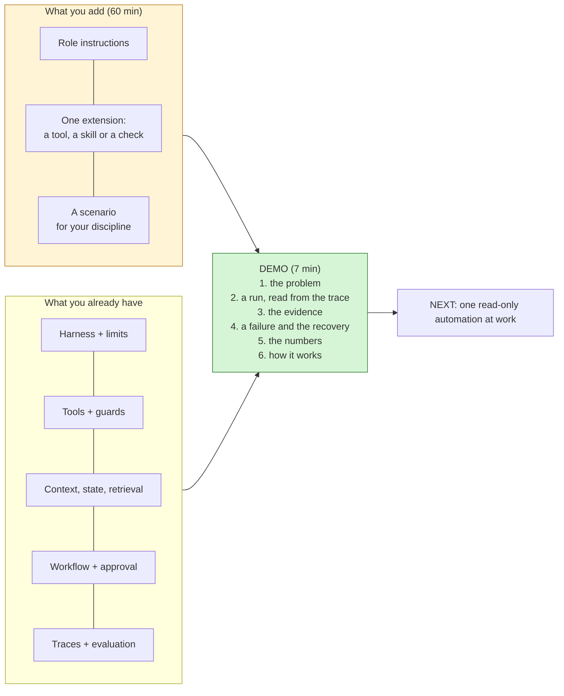

# Module 6: Final Project and Demonstration (2 hours)

**Course:** Building Practical AI Agents: GitHub Engineering Assistant
**Milestone:** each participant or pair demonstrates a working automation for their own discipline
**You will leave with:** an assistant specialised for your role, shown on a realistic problem with its tool usage,
its evidence, one failure it recovers from, and an explanation of how it works; plus a plan for taking it to work

> This file and `module_6_final_project.ipynb` have the same content. The notebook is a **template**: run it as it
> is first, then replace the marked parts with your own.

---

## The Big Picture

No new concept in this module. You assemble what you built, point it at a problem from your own field, and
explain it to colleagues from the other two fields.



<details>
<summary>▶ <b>Can't see the diagram? Text version</b></summary>

```text
You add:   role instructions + one extension (a tool, a skill or a check) + a scenario for your discipline
You have:  harness and limits, tools and guards, context/state/retrieval, workflow and approval, traces and evaluation
Demo (7 minutes): the problem → a run read from its trace → the evidence → a failure and the recovery
                  → the numbers → how it works
Next:      one read-only automation at work
```

</details>

---

## How to Use These Two Hours

| Step | What | Time |
|---|---|---|
| 1 | Choose a track and a scenario | 10 min |
| 2 | Run the template end to end, unchanged | 15 min |
| 3 | Build your extension | 45 min |
| 4 | Add a failure and recovery scene | 15 min |
| 5 | Evaluate; collect your numbers | 15 min |
| 6 | Prepare and give the demonstration | 20 min |

Working in a pair across disciplines (a DBA with a QA engineer, for example) makes better projects than working
alone: one of you knows what a good answer looks like, the other asks the questions an outsider would.

---

## Step 1: Choose a Track

| Track | Goal from the course outline | Main case | Review case | What a strong demo shows |
|---|---|---|---|---|
| **SWE** | Investigate a bug report, find the root cause in code, review a proposed fix | `issue-104` (pagination) | `pr-204` (order search) | The trace from API route to SQL; a security problem caught in review |
| **DBA** | Investigate a slow query, gather diagnostic evidence, recommend improvements | `issue-102` (slow endpoint) | `pr-202` (migration) | Both execution plans; the migration that dropped the index; a safe rollout |
| **QA** | Analyse an issue and its pull request, find missing test scenarios, recommend regression coverage | `issue-103` (rounding) | `pr-203` (bulk discount) | Why the existing tests passed; boundary cases; a flaky test explained |
| **Cross-functional** | The outline's example: a data mismatch touching code, data and tests | `issue-101` | `pr-201` | All three views of one defect, and why the proposed fix is incomplete |

### Ideas for the extension

Pick **one**. Small and finished beats ambitious and half done.

| Track | A tool | A skill (see Module 7) | A check |
|---|---|---|---|
| SWE | `get_function(path, name)`: one function's source; `find_callers(name)` | `api-change-review`: your team's rules for endpoints | A final check that every problem names a file and a line |
| DBA | `table_stats(table)`; `index_advice(query)` that compares a query's columns with existing indexes | `migration-review`: your own checklist | A workflow validation rule: a migration review must mention locking |
| QA | `get_test_source(name)`; `list_untested_functions()` from a search of `tests/` | `test-design`: boundary and equivalence rules for your product | A grader that counts concrete values in `regression_tests` |
| Any | `reconcile_order(order_id)` (provided below as a worked example) | | A new evaluation case with expected findings |

---

## Setup

```python
import json
import sys
from pathlib import Path


def find_course_dir() -> Path:
    here = Path.cwd().resolve()
    for folder in [here, *here.parents]:
        for candidate in (folder, folder / "github-engineering-assistant"):
            if (candidate / "assistant" / "harness.py").exists():
                return candidate
    raise FileNotFoundError("Start Jupyter (or Python) from inside the course folder.")


COURSE_DIR = find_course_dir()
if str(COURSE_DIR) not in sys.path:
    sys.path.insert(0, str(COURSE_DIR))

from dotenv import load_dotenv

load_dotenv(COURSE_DIR / ".env")

from assistant.app import ROLE_PROMPTS, build_assistant, issue_task, pr_task
from assistant.evals import load_cases, report, run_eval, task_for
from assistant.findings import render_markdown
from assistant.harness import Limits
from assistant.llm import llm_status
from assistant.tracing import Tracer, summarize
from assistant.workspace import default_workspace
from lab.models import model_for
from lab.standin import ScriptedModel

STATUS = llm_status()
USE_LLM = STATUS.ready
workspace = default_workspace()
print(STATUS)
print("Mode:", "live model" if USE_LLM else "scripted stand-in (no model configured)")
```

---

## Step 2: The Template, Unchanged

Set your role and cases. Everything below reads these three variables.

```python
ROLE = "dba"                      # "swe", "dba" or "qa"
MAIN_CASE = "issue-102"           # the investigation you will demonstrate
REVIEW_CASE = "pr-202"            # the review you will demonstrate

print("Role instructions added to the system prompt:\n ", ROLE_PROMPTS[ROLE])
```

```python
def run(case_id, *, tracer=None, **options):
    kind, number = case_id.split("-")
    task = issue_task(int(number)) if kind == "issue" else pr_task(int(number))
    assistant = build_assistant(model_for(case_id), role=ROLE, task=task, tracer=tracer, **options)
    return assistant.agent.run(task), assistant


main_tracer = Tracer(echo=True)
main_result, main_assistant = run(MAIN_CASE, tracer=main_tracer)
```

> **✅ Checkpoint.** A complete trace for your main case, ending in `completed (submitted)`.

```python
print(render_markdown(main_result.findings))
```

```python
review_result, _ = run(REVIEW_CASE)
for problem in review_result.findings["problems"]:
    print(f"[{problem['severity']:<7}] {problem['title']}")
```

> **✅ Checkpoint.** The findings for your investigation, and the list of problems found in your review case.
> This is your baseline. Everything you add in Step 3 should make one of these better, or cheaper, or safer.

---

## Step 3: Your Extension

Here is one worked example, so that the template runs. **Replace it with your own.**

`reconcile_order` answers in one call the question that took three queries in issue #101: do the order total,
the invoice and the charge agree? It is a specialised tool in the sense of Module 2, Lab B: narrow, safe, cheap.

```python
import sqlite3

from pydantic import BaseModel, Field

from assistant.guards import ToolError
from assistant.tools import Tool


class ReconcileArgs(BaseModel):
    order_id: int = Field(ge=1, description="The order number, for example 6800.")


def reconcile_order(order_id: int) -> str:
    conn = sqlite3.connect(f"file:{workspace.db}?mode=ro", uri=True)
    try:
        if conn.execute("SELECT 1 FROM orders WHERE id = ?", (order_id,)).fetchone() is None:
            raise ToolError("not_found", f"There is no order {order_id}.")
        active, removed = conn.execute(
            "SELECT COALESCE(SUM(CASE WHEN status = 'active' THEN quantity * unit_price_cents END), 0), "
            "COALESCE(SUM(CASE WHEN status = 'removed' THEN quantity * unit_price_cents END), 0) "
            "FROM order_items WHERE order_id = ?", (order_id,)).fetchone()
        invoice = conn.execute("SELECT total_cents FROM invoices WHERE order_id = ?", (order_id,)).fetchone()
        captured = conn.execute("SELECT COALESCE(SUM(amount_cents), 0) FROM payments WHERE order_id = ? "
                                "AND kind = 'capture' AND status = 'succeeded'", (order_id,)).fetchone()[0]
        code = conn.execute("SELECT discount_code FROM orders WHERE id = ?", (order_id,)).fetchone()[0]
    finally:
        conn.close()
    lines = [f"order {order_id} (amounts in cents; discount code: {code or 'none'})",
             f"active items subtotal : {active}", f"removed items subtotal: {removed}",
             f"invoice total         : {invoice[0] if invoice else 'no invoice'}", f"captured payments     : {captured}"]
    if invoice and not code:
        lines.append("invoice matches active items: " + ("yes" if invoice[0] == active else
                     f"NO, difference {invoice[0] - active}" + (" (equals the removed items)" if invoice[0] - active == removed else "")))
    return "\n".join(lines)


reconcile_tool = Tool(
    "reconcile_order",
    "Compare, for one order, the subtotal of its active items, the subtotal of removed items, the invoice total and "
    "the amount captured from the customer. Use it first whenever an issue reports that two amounts for an order "
    "disagree. Amounts are integer cents. Discounts are not applied to the subtotals.",
    reconcile_order, ReconcileArgs)

print(reconcile_tool.fn(order_id=6800))
```

> **✅ Checkpoint.** Five lines for order 6800, ending in
> `invoice matches active items: NO, difference 2500 (equals the removed items)`.

Give it to the assistant. The stand-in cannot use a tool it has no script for, so the cell uses a three-turn
script written for this demonstration when no model is configured.

```python
EXTENSION_SCRIPT = [
    {"say": "Two amounts disagree for one order: reconcile it first.",
     "calls": [{"name": "reconcile_order", "args": {"order_id": 6800}}]},
    {"say": "The invoice is higher by exactly the removed items, and the customer was charged the lower amount.",
     "calls": [{"name": "submit_findings", "args": {
         "kind": "issue_investigation", "verdict": "needs_more_info", "confidence": "medium",
         "summary": "For order 6800 the invoice total exceeds the active items by 2500 cents, which equals the "
                    "removed items. The customer was charged 15000 cents, the correct amount. The code path that "
                    "computes the invoice still has to be located.",
         "root_cause": "",
         "evidence": [{"source": "database", "ref": "reconcile_order(6800)",
                       "quote": "invoice matches active items: NO, difference 2500 (equals the removed items)"}],
         "recommendations": ["Search for the query that computes invoice totals from order_items."],
         "regression_tests": [], "open_questions": ["Which query builds the invoice total?"], "security_notes": []}}]},
]

extension_tracer = Tracer(echo=True)
task = issue_task(101)
extended = build_assistant(model_for("issue-101") if USE_LLM else ScriptedModel(EXTENSION_SCRIPT), role=ROLE, task=task,
                           tracer=extension_tracer, extra_tools=[reconcile_tool])
extension_result = extended.agent.run(task)
```

> **✅ Checkpoint (stand-in).** `reconcile_order` appears in the trace, and the findings quote its output. The
> quote check accepted it, which means your new tool's output is part of the evidence chain like any other.
> **Live:** does the model choose your tool first? If not, improve its description before anything else.

**Your turn.** Replace `reconcile_tool` with your extension. For a tool, keep the five parts of the contract
(Module 2): name, description with when to use it, argument schema, compact output with units, errors as data.
Then measure it against the baseline of Step 2: fewer steps, fewer tokens, or a better finding?

---

## Step 4: A Failure and a Recovery

The outline asks every demonstration to show **at least one failure or recovery scenario**. Three ready-made
scenes follow. Run all three, then keep the one that fits your story.

### Scene A: interrupted and resumed

```python
state_file = workspace.out / "state" / f"module6-{MAIN_CASE}.json"
state_file.unlink(missing_ok=True)
kind, number = MAIN_CASE.split("-")
task = issue_task(int(number)) if kind == "issue" else pr_task(int(number))

cut_short, _ = run(MAIN_CASE, state_path=state_file, limits=Limits(max_steps=5))
print(f"run 1: {cut_short.status} ({cut_short.stop_reason}) after {cut_short.tool_calls} tool calls")

resumed_assistant = build_assistant(model_for(MAIN_CASE), role=ROLE, task=task, state_path=state_file, resume=True)
resumed = resumed_assistant.agent.run(resumed_assistant.state.resume_prompt())
print(f"run 2: {resumed.status} ({resumed.stop_reason}) after {resumed.tool_calls} more tool calls")
```

> **✅ Checkpoint.** Run 1 stops at the step limit; run 2 continues from the saved plan and notes and submits
> findings. (If your live model finishes within five steps, lower the limit.)

### Scene B: a tool fails and the harness absorbs it

```python
from assistant.reliability import with_retries
from lab.faults import flaky_tool

FLAKY = {"issue-102": "get_slow_queries", "issue-103": "get_test_results", "issue-104": "run_sql", "issue-101": "run_sql"}
target = FLAKY.get(MAIN_CASE, "get_issue")

shaky = build_assistant(model_for(MAIN_CASE), role=ROLE, task=task)
wrapped = flaky_tool(shaky.agent.tools[target], fail_first=2)
shaky.agent.tools[target] = with_retries(wrapped, sleep=lambda seconds: None)
shaky_result = shaky.agent.run(task)
print(f"{target} failed {2} times before answering; calls made to it: {wrapped.fault_state['calls']}")
print(f"run: {shaky_result.status} ({shaky_result.stop_reason}); errors the model saw: {sum(not r.ok for r in shaky_result.ledger)}")
```

> **✅ Checkpoint.** The tool was really called more often than the model asked for, the run completed, and the
> model saw no error.

### Scene C: the planted instructions

```python
from assistant.harness import Approval
from lab.scripts import SCRIPTS

attack = build_assistant(ScriptedModel(SCRIPTS["issue-105-gullible"]), role=ROLE, task=issue_task(105), can_comment=True,
                         approver=lambda tool, args: Approval(False, "reviewer refused")).agent.run(issue_task(105))
for record in attack.ledger:
    print(f"{'ok ' if record.ok else 'ERR'} {record.name:<16} {record.kind}")
```

> **✅ Checkpoint.** The Module 5 attack: five refusals, one redacted read, nothing changed and nothing posted.
> This scene always uses a script, because it needs a model that misbehaves.

---

## Step 5: Your Numbers

Run the evaluation cases for your role, with your extension included.

```python
cases = load_cases(workspace.expected / "cases.json", role=ROLE)


def run_case(case):
    assistant = build_assistant(model_for(case["id"]), role=ROLE, task=task_for(case), extra_tools=[reconcile_tool])
    return assistant.agent.run(task_for(case))


grades = run_eval(cases, run_case)
print(report(grades, f"Role {ROLE}: {len(cases)} cases ({'live model' if USE_LLM else 'reference scripts'})"))
```

```python
main_summary = summarize(main_tracer.events)
print(json.dumps({key: main_summary[key] for key in ("steps", "tool_calls", "input_tokens", "output_tokens",
                                                     "largest_prompt_tokens", "tool_errors")}, indent=1))
```

> **✅ Checkpoint.** A report for your role's cases, and the cost of your main run. Write down three numbers for
> the demonstration: pass rate, tokens for the main run, and one before/after comparison from your extension.

With the stand-in the pass rate is that of the reference scripts. Say so in your demonstration; do not present
it as the result of a model.

---

## Step 6: The Demonstration

Seven minutes, then questions. The audience is your study group: assume they know the concepts and do not know
your discipline.

| Minute | Show | Tip |
|---|---|---|
| 0-1 | **The problem**, in your field's words. What would you do by hand, and how long does it take? | One sentence of context, then the issue text. |
| 1-3 | **One run**, read from the trace. Pick three steps and say why the assistant took each. | Do not scroll through everything. Choose the turning point. |
| 3-4 | **The evidence.** Open one reference from the findings and show that it exists. | This is what makes it more than a chatbot answer. |
| 4-5 | **A failure and the recovery.** One of the scenes from Step 4. | Say which component handled it: tool, harness, state, person. |
| 5-6 | **The numbers.** Pass rate, cost, your before/after. | And one thing it still gets wrong. |
| 6-7 | **How it works.** Use the table below; name the three concepts that matter most for your case. | Your colleagues should be able to repeat it. |

### Explaining the architecture

Fill in the right-hand column for your project. You should be able to say each line without notes.

| Concept | One sentence | In my demonstration |
|---|---|---|
| LLM and prompt | A stateless text function; the prompt states the role, the rules and what it cannot know. | |
| Tool calling | The model asks; my code runs the function and returns the result as data. | |
| Loop and harness | Ask, act, observe, repeat, inside checks and limits the model cannot change. | |
| Context engineering | Decide what the model sees each step: prevent, clip, clear, persist. | |
| Planning | A visible plan with a stopping rule: explained, scoped, fix named. | |
| Memory | Context is temporary; state on disk survives; lessons carry across tasks. | |
| RAG | Search the team's history, show only the matching passages, quote them. | |
| MCP | A standard way to offer tools from the system that owns them. | |
| Skills | Procedures loaded on demand instead of living in the prompt. | |
| Workflow | Fixed steps around the loop, with checkpoints. | |
| Human in the loop | A person decides before anything consequential happens. | |
| Multi-agent | Separate contexts for separate jobs, at a cost. | |
| Observability and evaluation | Record everything; measure against known answers. | |
| Security | Controls that hold whatever the model outputs. | |

### Feedback form for the audience

Each listener answers three questions for each demonstration:

1. Which step of the run would you have done differently, as someone from another discipline?
2. Which claim in the findings would you want to verify yourself before acting on it?
3. What is the first thing that would break if this ran against your real system?

---

## Taking It to Work

The workshop was built so that every part has a real counterpart.

| In the workshop | At work | First question to ask |
|---|---|---|
| `LocalGitHub` fixtures | GitHub, GitLab, Jira (REST, or their MCP servers) | Which token, with which scopes? Read-only first. |
| SQLite copy, `run_sql` | A read replica with a read-only role | Which tables and columns does it need? Remove the rest. |
| `workshop/ops/` files | Your monitoring, CI and log systems | Is there an API, and how large are the results? |
| `workshop/knowledge/` | Post-mortems, runbooks, wiki | Who keeps them current? Stale runbooks produce confident wrong advice. |
| `out/outbox/` | Real comments and tickets | Who approves, and where is the approval recorded? |
| `expected/cases.json` | Ten of your own closed incidents and reviewed pull requests | Who writes down the expected findings? |
| The stand-in | Recorded runs and scripted fakes in your CI | Which harness behaviours must never regress? |

### A ladder, not a leap

| Rung | The assistant may | You need first |
|---|---|---|
| 1 | Read, and draft findings that only you see | Read-only credentials; a trace of every run |
| 2 | Draft comments for a person to post | Ten evaluation cases; an approval step |
| 3 | Post comments after approval | An audit log; redaction; a way to switch it off |
| 4 | Post low-risk comments on its own (for example labels, links to similar incidents) | Measured precision on real traffic; alerting on anomalies |
| 5 | Propose changes (a branch, a migration) for review | Everything above, plus sandboxed execution |

Most of the value is on rungs 1 to 3, and so is nearly none of the risk. Climb when the numbers say so.

### Before you connect anything real

- [ ] What can it **read**? Is any of that personal, secret or regulated?
- [ ] What can it **change or send**? List every outward channel.
- [ ] Which **untrusted text** reaches it? (Issues, files, tickets, web pages, tool results.)
- [ ] What does a run **cost**, and what stops a runaway run?
- [ ] Where are the **traces**, who can read them, how long are they kept?
- [ ] How do you **know it is right**? Which cases, graded how, run when?
- [ ] Who **owns** it when it is wrong at 3 a.m.?

---

## Course Wrap-Up: Can You Now...?

The six expected outcomes of the course, as questions. Answer each in two or three sentences in your own words.
If one is hard, the module on the right is where to look again.

| Outcome | Check yourself | Module |
|---|---|---|
| Explain how agents such as Codex and Claude Code work | What happens between your request and the first tool call? What does the harness do that the model does not? | 2 |
| Build an agent loop and harness without a framework | Write the loop from memory in 20 lines. Name five checks that belong around it. | 2 |
| Tell tool calling, RAG, MCP, connectors, memory and orchestration apart | For each: what problem does it solve, and what would you use instead? | 2, 3, 4 |
| Integrate agents with external systems under appropriate controls | Where is the read-only guard for a database tool, and why there? What needs approval? | 2, 4, 5 |
| Evaluate accuracy, reliability, cost and security | How do you know a prompt change helped? What do you inject to test reliability? | 5 |
| Build a useful automation for your discipline | You just did. What is the next rung of the ladder for it? | 6 |

**Optional next:** [Module 7: Skills, long-term memory and multi-agent experiments](module_7_optional_extensions.md).
