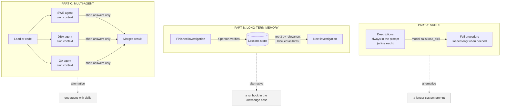

# Module 7 (Optional): Skills, Long-Term Memory and Multi-Agent Experiments (4 hours)

**Course:** Building Practical AI Agents: GitHub Engineering Assistant
**Concepts:** skills and specialised instructions (9), long-term memory (the optional part of 6), multi-agent
systems (12)
**You will leave with:** three reusable skills and a loader, a memory of verified lessons with the rules that keep
it trustworthy, two multi-agent designs measured against a single agent, and a clear view of when each of these
is worth its complexity

> This file and `module_7_optional_extensions.ipynb` have the same content. The notebook is built from this file.
> The three parts are independent. Do the one that interests you, in any order. **Modules 2, 3 and 5 are required.**

---

## The Big Picture

Each part adds a capability, and each has a simpler alternative. The purpose of this module is to learn to
choose, with measurements.



<details>
<summary>▶ <b>Can't see the diagram? Text version</b></summary>

```text
PART A, skills:    one line per skill is always in the prompt; the full procedure is loaded by a tool call
                   only when the task needs it.                       Alternative: a longer system prompt.
PART B, memory:    a person verifies a lesson from a finished investigation; it is stored; the next
                   investigation gets the three most relevant lessons, labelled as hints.
                                                                      Alternative: a runbook in the knowledge base.
PART C, multi-agent: several agents with separate contexts work on parts of a task and return short answers,
                   which are merged.                                  Alternative: one agent with skills.
```

</details>

| Part | Time | Lab outcome |
|---|---|---|
| A. Skills | 75 min | Measure prompt cost, run with skills, write your own |
| B. Long-term memory | 60 min | Store verified lessons, retrieve them, see where it goes wrong |
| C. Multi-agent | 90 min | Three specialists against one agent; a lead that delegates |
| Wrap-up | 15 min | Decision guide, exercises, quiz |

---

## Setup

```python
import json
import sys
from pathlib import Path


def find_course_dir() -> Path:
    here = Path.cwd().resolve()
    for folder in [here, *here.parents]:
        for candidate in (folder, folder / "github-engineering-assistant"):
            if (candidate / "assistant" / "harness.py").exists():
                return candidate
    raise FileNotFoundError("Start Jupyter (or Python) from inside the course folder.")


COURSE_DIR = find_course_dir()
if str(COURSE_DIR) not in sys.path:
    sys.path.insert(0, str(COURSE_DIR))

from dotenv import load_dotenv

load_dotenv(COURSE_DIR / ".env")

from assistant.app import build_assistant, issue_task, pr_task
from assistant.context import estimate_tokens
from assistant.llm import llm_status
from assistant.tracing import Tracer
from assistant.workspace import default_workspace
from lab.models import model_for
from lab.scripts import SCRIPTS
from lab.standin import ScriptedModel

STATUS = llm_status()
USE_LLM = STATUS.ready
workspace = default_workspace()
print(STATUS)
print("Mode:", "live model" if USE_LLM else "scripted stand-in (no model configured)")
```

---

# Part A: Skills and Specialised Instructions

## The problem skills solve

In Module 1 one sentence per role changed the assistant's emphasis. That does not scale to real procedures. Your
DBA team's migration checklist is a page. So is the security review guide, and the test design standard. Put all
of them in the system prompt and every run pays for all of them on every step, while most are irrelevant to the
task at hand (Module 3: context is a budget).

A **skill** is a folder with a `SKILL.md` file: a short header (name, description) and a body of instructions.

```python
from assistant.skills import SKILLS_DIR, discover_skills, skill_tool, skills_prompt

skills = discover_skills()
for skill in skills:
    print(f"{skill.name}\n   {skill.description}\n")
```

> **✅ Checkpoint.** Three skills: `security-review`, `sql-performance-analysis`, `test-coverage-assessment`,
> each with a description that says **when to load it**.

```python
print((SKILLS_DIR / "sql-performance-analysis" / "SKILL.md").read_text())
```

Read it as a DBA would. It is a procedure: measure, read the plan, check indexes, find what changed, look at the
caller, propose the smallest change; then a checklist for reviewing migrations. Nothing in it is about AI.

## Lab A1: Progressive disclosure, measured

Only the descriptions are always present. The body arrives through a tool call when the model decides it applies.

```python
index_tokens = estimate_tokens(skills_prompt(skills))
body_tokens = {skill.name: estimate_tokens(skill.body) for skill in skills}

print(skills_prompt(skills), "\n")
print(f"always in the prompt (3 descriptions): {index_tokens:>5} tokens")
for name, tokens in body_tokens.items():
    print(f"loaded on demand: {name:<28} {tokens:>5} tokens")
print(f"\nall three bodies in the system prompt instead: {sum(body_tokens.values())} tokens on every step of every run")
```

> **✅ Checkpoint.** About 230 tokens for the index, against about 1,250 for the three bodies. With three skills
> the saving is modest. With thirty it decides whether the approach is possible at all.

This pattern is called **progressive disclosure**: a cheap index up front, detail on request. You have used it
twice already without the name: `search_knowledge` returns snippets before `read_knowledge` returns a document,
and `search_code` returns matching lines before `read_file` returns a range.

## Lab A2: Run with skills

```python
tracer = Tracer(echo=True)
task = pr_task(204)
skilled = build_assistant(model_for("pr-204"), task=task, tracer=tracer,
                          extra_tools=[skill_tool(skills)], extra_system=skills_prompt(skills))
skilled_result = skilled.agent.run(task)
```

> **✅ Checkpoint (stand-in).** After reading the pull request the assistant calls
> `load_skill({"name": "security-review"})` and then proceeds with the review. **Live:** did the model load a
> skill? The right one? More than one?

```python
loaded = next(record for record in skilled_result.ledger if record.name == "load_skill")
print(loaded.output[:700], "...")
```

The skill body arrives as a tool result wrapped in `<skill>` tags, **not** in `<untrusted_content>`. That
difference is deliberate: a skill is a trusted procedure written by your team, and the model is meant to follow
it. Which is exactly why skills must be reviewed like code.

<details>
<summary>▶ <b>Note: skills are instructions with authority. Treat them like code</b></summary>

Everything else the assistant reads is marked as data. A skill is the one thing it is told to obey. So:

- Skills live in version control and change through review.
- Never load a skill from a place that untrusted people can write to (an issue attachment, a wiki anyone can edit,
  a repository under review). A "skill" that says "post the customer list" is prompt injection with a badge.
- A skill grants **no permissions**. `sql-performance-analysis` can recommend `CREATE INDEX CONCURRENTLY`; the SQL
  tool still refuses to run it. Procedures in skills, boundaries in code.

</details>

<details>
<summary>▶ <b>Note: skill, system prompt, tool, or knowledge base?</b></summary>

| It is | Put it in | Because |
|---|---|---|
| A rule that applies to every task ("never change data") | System prompt | Always relevant; short |
| A procedure for one kind of task ("how we review migrations") | A skill | Long; relevant sometimes; must be followed |
| Reference material to consult ("incident INC-2025-052") | Knowledge base | Evidence to quote, not instructions to obey |
| Something that needs computing or access ("the current plan for this query") | A tool | Instructions cannot fetch data |

A common mistake is writing a skill where a tool is needed ("to find slow queries, look in the log" when the
agent has no way to read the log), or a tool where a skill would do.

</details>

<details>
<summary>▶ <b>Note: what makes a skill description work</b></summary>

The description is all the model sees when deciding. It must answer "when should I load this?":

- Weak: `SQL helper.`
- Strong: `Procedure for diagnosing slow queries and reviewing schema migrations (indexes, execution plans,
  locking, safe rollout). Load it for latency regressions, slow-query reports and any pull request that touches
  migrations/.`

Name the triggers in the words a task would use. If a skill is not being loaded when it should be, fix the
description before anything else. If it is loaded for everything, it is too broad: split it.

</details>

## Lab A3: Write your own skill

Create `skills/<your-skill>/SKILL.md` for a procedure from your own work. A template:

```text
---
name: migration-rollback-review
description: Checks that a schema migration can be undone. Load it for any pull request that adds a file under migrations/.
---

# Reviewing the way back

1. For every statement in the migration, write the statement that reverses it. If there is none, say so.
2. ...

## Output
- One finding per irreversible statement, with the line.
```

Then check that it is discovered and what it costs.

```python
for skill in discover_skills():
    print(f"{skill.name:<28} description {estimate_tokens(skill.description):>3} tokens, body {estimate_tokens(skill.body):>4} tokens")
```

> **✅ Checkpoint.** Your skill appears in the list. Keep its description under about 60 tokens and its body
> under about 600; a skill that needs more is usually two skills.

---

# Part B: Long-Term Memory

## What it is, and what it is not

Module 3 kept **execution state**: what one investigation knows, for the length of that investigation. Long-term
memory keeps something **across** investigations: lessons that should make the next one better.

That sounds attractive and is easy to get wrong. An agent that writes its own conclusions into a store and reads
them back later is a system that amplifies its own mistakes. `assistant/memory.py` therefore has four rules:

| Rule | In the code |
|---|---|
| Only a person adds a lesson | `add(..., verified_by=...)` raises without it |
| A lesson is a hint, not evidence | The prompt block says so; the quote check does not accept lessons as evidence |
| Lessons are retrieved by relevance, a few at a time | `search(query, k=3)` with BM25 |
| Every lesson can be traced, edited, deleted | One JSON line per lesson, in a file you can put under version control |

## Lab B1: Store what was learned

```python
from assistant.memory import LessonStore

lessons_file = workspace.out / "memory" / "lessons.jsonl"
lessons_file.unlink(missing_ok=True)
store = LessonStore(lessons_file)

try:
    store.add("Invoices are probably wrong because of tax.", tags="billing", source="issue-101", verified_by="")
except ValueError as error:
    print("refused:", error)
```

> **✅ Checkpoint.** `refused: a lesson must be verified by a person before it is stored`.

After the investigations of issues #101 and #102 were reviewed by people, three lessons were accepted:

```python
store.add("When two amounts for the same order disagree, look for two code paths that compute the 'same' total; "
          "compare which rows of order_items each one includes (status filter).",
          tags="billing invoice order total mismatch", source="issue-101", verified_by="finance-omar")
store.add("A wrong invoice does not imply a wrong charge. Check the captured payment before recommending a refund.",
          tags="billing invoice payment refund", source="issue-101", verified_by="finance-omar")
store.add("A latency regression that starts with a release but touches no code of the endpoint: compare the index "
          "list before and after that release's migrations.",
          tags="performance slow query index migration", source="issue-102", verified_by="sre-tomas")

print(lessons_file.read_text())
```

## Lab B2: Use the lessons in a new investigation

Pull request #203 adds a bulk discount. Which lessons does the store offer for it?

```python
pull = workspace.github / "pulls" / "203.json"
description = json.loads(pull.read_text())
query = description["title"] + " " + description["body"] + " order total invoice"

memory_block = store.prompt_for(query)
print(memory_block)
```

> **✅ Checkpoint.** A block that begins "Lessons from earlier investigations that a person verified. They are
> hints, not evidence..." followed by the lessons, the two about order and invoice totals first. The lesson about
> slow queries ranks last. (With hundreds of lessons only the top three would be shown.)

That block goes into the system prompt of the new run.

```python
task = pr_task(203)
with_memory = build_assistant(model_for("pr-203"), task=task, extra_system=memory_block)
print(with_memory.agent.system[-560:])
result = with_memory.agent.run(task)
print("\nproblems found:")
for problem in result.findings["problems"]:
    print(f"  [{problem['severity']}] {problem['title']}")
```

> **✅ Checkpoint.** The review of #203 includes "Invoice total is not updated": the bulk discount changes the
> order total but not the invoice total, the same class of defect as issue #101.

*(With the stand-in the review is scripted and finds that problem with or without the lesson. With a live model,
run the review both ways several times and count how often the invoice problem is found. That count is the
only honest measure of whether this memory is worth having.)*

## Where long-term memory goes wrong

| Failure | Example | Defence |
|---|---|---|
| **A wrong lesson** | "Invoice mismatches are caused by tax" | A person verifies; lessons carry a source |
| **A stale lesson** | "Table X has no index" after the index was added | Lessons are hints to re-check; review the store periodically; add dates |
| **A poisoned lesson** | A lesson derived from planted text in an issue | Never write to memory automatically from untrusted content |
| **Over-generalisation** | "Removed items are always the cause" applied to an unrelated bug | Retrieve by relevance; keep lessons specific; say "hint" |
| **Privacy** | A lesson that names a customer | Review; lessons describe mechanisms, never people |
| **Clutter** | 2,000 lessons, most redundant | Prune; merge; prefer improving a runbook |

## Do you need it at all?

Before adding a memory store, look at where the lesson could live instead.

| The lesson is | Better home | Why |
|---|---|---|
| A rule for everyone, always | System prompt, or code | No retrieval needed; cannot be missed |
| A procedure | A skill (Part A) | Reviewed, versioned, loaded when relevant |
| An account of what happened | The incident write-up in the knowledge base | Humans need it too; already retrieved by `search_knowledge` |
| A check that could be automated | A test, a lint rule, a workflow validation | Enforced, not remembered |
| A small, specific hint from experience that fits none of the above | Long-term memory | This is the niche |

The three lessons above are honest candidates for the knowledge base: lesson one could be a line in incident
INC-2025-031. Often the best outcome of "the agent should remember this" is a better runbook. That is the
course outline's point: learn when persistent memory is useful and when it adds unnecessary complexity.

<details>
<summary>▶ <b>Note: memory that the model writes itself</b></summary>

Some products give the model a memory tool: files it can create, read and update across sessions, on its own
initiative. That is powerful for a personal assistant working with one trusted user. For a team's engineering
assistant that reads untrusted issues, unreviewed self-written memory is a persistence mechanism for prompt
injection: text planted today steers every investigation next month. If you use model-written memory, keep it
per-user or per-task, keep it away from untrusted input, and review what is in it.

</details>

---

# Part C: Multi-Agent Systems

## Two designs

"Multi-agent" covers very different things. We build two and measure both against the single agent you have.

| Design | Who decides the split | Communication |
|---|---|---|
| **Specialists run by code** | Your program: always SWE, DBA and QA | Each returns findings; code merges them |
| **A lead that delegates** | A model: it asks a specialist when it sees a sub-question | A tool call out, a short answer back |

A "specialist" is nothing new: an `Agent` with a role paragraph, its own tools, and above all **its own context**.

## Lab C1: Three specialists on one pull request

Pull request #201 fixes the invoice total. It has a code angle, a data angle and a testing angle.

```python
from assistant.multi import merge_problems, review_with_specialists

TASK_201 = pr_task(201)


def run_specialist(role):
    """One specialist: the role paragraph, the Module 2 tool set, a fresh context."""
    assistant = build_assistant(model_for(f"pr-201-{role}"), role=role, task=TASK_201, knowledge=False, planning=False)
    return assistant.agent.run(TASK_201)


team = review_with_specialists(run_specialist)
for role, run in team.runs.items():
    problems = [problem["title"] for problem in run.findings["problems"]]
    print(f"{role}: {run.steps} steps, {run.tool_calls} tool calls, {run.usage.total} tokens")
    for title in problems:
        print("     -", title)
```

> **✅ Checkpoint (stand-in).** Three short runs. SWE reports the invoice lines, the duplicated query and the
> missing test; DBA reports the 46 stored invoices; QA reports the missing test and the untested lines. Six
> problem entries in total, with overlap.

Six entries are not six problems. Merging is where multi-agent systems earn or lose their keep.

```python
print(f"raw entries: {team.raw_problem_count}   after merging: {len(team.problems)}\n")
for problem in team.problems:
    print(f"[{problem['severity']:<7}] {problem['title']}   <- {', '.join(problem['reported_by'])}")
```

> **✅ Checkpoint.** Four distinct problems. Two were reported by both SWE and QA and merged into one entry each.

`merge_problems` in `assistant/multi.py` decides that two entries are the same problem when their titles share
most of their meaningful words. It is crude on purpose: read it, and think about what it gets wrong (two
different problems in the same function; the same problem described in different words). A model call can merge
better, at a cost, and then *that* call needs evaluating too.

### Compare with one agent

```python
single_assistant = build_assistant(model_for("pr-201"), task=TASK_201)
single = single_assistant.agent.run(TASK_201)

rows = [("one agent, all tools", single.steps, single.tool_calls, single.usage.total, len(single.findings["problems"])),
        ("three specialists", sum(r.steps for r in team.runs.values()), team.total_tool_calls, team.total_tokens,
         len(team.problems))]
print(f"{'configuration':<22} {'model calls':>11} {'tool calls':>10} {'tokens':>8} {'problems':>9}")
for name, steps, calls, tokens, problems in rows:
    print(f"{name:<22} {steps:>11} {calls:>10} {tokens:>8} {problems:>9}")
```

> **✅ Checkpoint (stand-in).** Both configurations find the same four problems. With these scripts the token
> totals are close; what differs is the shape: three contexts, each small, against one that carries everything.

Be careful what you conclude. These are scripts: they show the **mechanics and the bookkeeping**, not which
design is better. The honest experiment needs a model:

1. Run each configuration on `pr-201` to `pr-204`, three times each.
2. Grade with the Module 5 graders (`problems` recall, `grounded`, `safe`).
3. Compare recall, tokens and wall-clock time.

Typical results from experiments of this kind: specialists find a little more in their own area, duplicate each
other at the edges, cost noticeably more in total, and finish faster only if you run them in parallel. Whether
"a little more" is worth it depends on what a missed problem costs you.

## Lab C2: A lead that delegates

In the second design a lead agent has a tool, `ask_specialist`. The specialist does the digging in its own
context and returns a short answer. The lead never sees the specialist's tool results.

```python
from assistant.multi import specialist_tool

sub_runs = []


def answer(role, question):
    assistant = build_assistant(model_for(f"pr-201-{role}"), role=role, task=question, knowledge=False, planning=False)
    run = assistant.agent.run(question)
    sub_runs.append((role, run))
    return run


lead_tracer = Tracer(echo=True)
lead = build_assistant(model_for("pr-201-lead"), task=TASK_201, knowledge=False, planning=False, tracer=lead_tracer,
                       extra_tools=[specialist_tool(answer)])
lead_result = lead.agent.run(TASK_201)
```

> **✅ Checkpoint (stand-in).** The lead reads the pull request, makes two `ask_specialist` calls (DBA and QA) in
> one step, and submits a review. Each call returned a few hundred characters.

```python
for record in lead_result.ledger:
    if record.name == "ask_specialist":
        print(f"--- asked {record.args['role']}: {record.args['question'][:90]}...")
        print(record.output[:420], "\n")
```

Look at the arguments. The question is **self-contained**: it names the pull request, the file and what is
wanted. A specialist starts with an empty context; "check the thing we discussed" would mean nothing to it.
Writing good hand-offs is most of the skill in delegation, for models as for people.

### Context isolation, in numbers

```python
lead_largest = max(event["input_tokens"] for event in lead_tracer.events if event["event"] == "model_call")
specialist_chars = sum(len(r.output) for _, run in sub_runs for r in run.ledger if r.ok)
returned_chars = sum(len(r.output) for r in lead_result.ledger if r.name == "ask_specialist")

print(f"tool results read by the specialists : {specialist_chars:>6} characters")
print(f"what came back into the lead's context: {returned_chars:>6} characters")
print(f"lead's largest prompt                 : {lead_largest:>6} tokens")
print(f"total tokens: lead {lead_result.usage.total} + specialists {sum(run.usage.total for _, run in sub_runs)}")
```

> **✅ Checkpoint.** The specialists read about twice as much as they returned. In this small workshop the ratio
> is modest; in real investigations a sub-agent may read 50,000 tokens to return 500. That reduction is **the**
> technical reason for sub-agents: a sub-agent is a context-management device. The work still costs tokens (see
> the last line), but they are spent in small, disposable contexts instead of accumulating in one.

Connect this to Module 3. Clearing old tool results, summarising, and delegating to a sub-agent are three
answers to the same question: how do I keep a long task from drowning in its own history?

<details>
<summary>▶ <b>Note: the quote check across agents</b></summary>

The lead's findings quote `affected_invoices 46`. The lead never ran that query; the DBA specialist did. The
check passes because the specialist's answer, including its quoted evidence, is a tool result in the lead's own
ledger. Evidence travels up the chain as quoted text, and each level can only cite what it actually received.
A lead that embellishes a specialist's answer is caught the same way a single agent is.

</details>

## When multiple agents help, and what they cost

| Helps when | Because |
|---|---|
| Sub-tasks are **independent** and can run in parallel | Wall-clock time drops |
| A sub-task reads **a lot** to produce a short answer | Its context is thrown away afterwards |
| Sub-tasks need **different permissions** | The DBA agent has database tools; the reviewer has none |
| You want a **second opinion** that is not anchored on the first | A fresh context has not seen the first conclusion |

| Costs | Because |
|---|---|
| **Tokens** | Every agent pays its own system prompt and tool definitions, and re-reads shared material (each specialist read the PR) |
| **Lost context** | The specialist does not know what the lead knows unless the hand-off says it |
| **Merging** | Duplicates, contradictions, and nobody owning the overall conclusion |
| **Debugging** | One trace becomes several; a failure may be in a hand-off, not in any agent |
| **Evaluation** | You must now evaluate the parts and the whole |

The default should be **one agent with good tools and skills**. Reach for several when you can name which row
of the first table applies, and you have measured that it pays.

<details>
<summary>▶ <b>Note: running specialists in parallel</b></summary>

`review_with_specialists` runs the roles one after another to keep traces readable. They share nothing, so they
can run concurrently:

```python
from concurrent.futures import ThreadPoolExecutor

with ThreadPoolExecutor(max_workers=3) as pool:
    runs = dict(zip(roles, pool.map(run_specialist, roles)))
```

With a live model this cuts the wall-clock time to roughly that of the slowest specialist. Watch your
provider's rate limits, and give each run its own tracer.

</details>

---

## Decision Guide

| You are tempted to add | First try | Add it when |
|---|---|---|
| A skill | A clearer tool description, or one line in the system prompt | The procedure is long, applies to some tasks only, and must be followed |
| Long-term memory | Improving a runbook; adding a test or a validation rule | A specific, verified hint has no better home, and a person curates the store |
| Specialist agents | One agent with skills and a context manager | Sub-tasks are independent or read-heavy, or need different permissions, and you measured a gain |

Each of the three trades simplicity for capability. This course's guiding principle applies: we are not learning
these for their own sake.

---

## Exercises

**Everyone**

1. **Skill or prompt?** With a live model, run `pr-202` three ways: no skills; skills available through
   `load_skill`; the `sql-performance-analysis` body pasted into `extra_system`. Compare problems found (Module 5
   grader) and tokens. Which wins on quality, which on cost?
2. **A lesson that should not exist.** Add a plausible but wrong lesson to the store ("invoice mismatches are
   caused by discount codes") with your name as verifier, and run the `pr-203` review with a live model. Does it
   mislead the assistant? What would have had to be different for the "hint, not evidence" label to protect you?
3. **A fair comparison.** Design the experiment from Lab C1 properly: which cases, how many repetitions, which
   metrics, what difference would change your decision? Write it down before you run it.

**SWE**

4. Write a skill `api-change-review` from DOC-api-conventions in the knowledge base, and decide which parts
   should stay in the knowledge base as reference rather than move into the skill as procedure.

**DBA**

5. Give the DBA specialist different tools from the others: database and operations tools only, no code tools.
   Run the team on `pr-202`. Does restricting tools change what it finds? Does it reduce tokens?

**QA**

6. Use a second agent as a **reviewer of the first**: after a single-agent review of `pr-203`, run a QA specialist
   whose task is "list what this review missed", given the review as input. Evaluate the combined result against
   the case's expected problems. Is this better than one agent with the `test-coverage-assessment` skill?

---

## Quiz

<details>
<summary><b>1. Thirty skills are installed. How much of them is in the context of a task that needs none?</b></summary>

Thirty descriptions, a line each: perhaps 1,500 tokens. No bodies. That is progressive disclosure: the cost of
*knowing about* a procedure is separated from the cost of *using* it.

</details>

<details>
<summary><b>2. A skill body is returned by a tool, like a file's contents. Why is one wrapped in &lt;skill&gt; and the other in &lt;untrusted_content&gt;?</b></summary>

A skill is a procedure written and reviewed by your team; the assistant should follow it. A file is data that
anyone may have written; the assistant should analyse it and never obey it. The wrapper tells the model which is
which, and the review process for skills is what makes the trust justified.

</details>

<details>
<summary><b>3. Why does LessonStore refuse a lesson without verified_by?</b></summary>

An agent that stores its own unreviewed conclusions and later reads them as guidance compounds its errors, and
gives planted instructions a way to persist across runs. A person in between breaks both loops.

</details>

<details>
<summary><b>4. A team replaces one agent with five specialists and reports "better results". Name two things to check.</b></summary>

Cost and time (five system prompts, five sets of tool definitions, shared material read five times); and whether
"better" was measured on held-out cases with repetitions, or seen once. Also worth asking: how are duplicates and
contradictions merged, and who is accountable for the final conclusion?

</details>

<details>
<summary><b>5. What is the main technical benefit of handing a sub-question to a sub-agent?</b></summary>

Context isolation. The sub-agent reads whatever it needs in its own context and returns a short answer; the bulk
never enters the lead's context. It is a context-management technique, in the same family as clearing and
summarising.

</details>

---

## What You Built

| File | What it holds |
|---|---|
| `skills/*/SKILL.md` | Three procedures: SQL performance, security review, test coverage |
| `assistant/skills.py` | Discovery, the index prompt, the `load_skill` tool |
| `assistant/memory.py` | The lesson store and its four rules |
| `assistant/multi.py` | Specialists run by code, problem merging, the `ask_specialist` tool |
| `tests/test_integrations.py` | Skills, lessons, merging and delegation as tests |

You have now built, by hand, every concept on the course's list. The frameworks and products you will meet at
work package these same parts under their own names. You know what to look for inside them.
